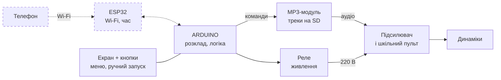
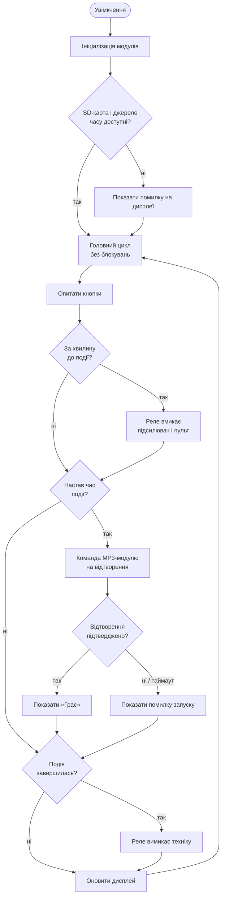

# STEM-93: шкільний аудіоплеєр за розкладом

Невеликий вбудований аудіоплеєр, який відтворює вибрані MP3-файли у заданий час. Час, стан і розклад показуються на OLED-дисплеї, а розклад змінюється двома кнопками (з уроку 3); годинник встановлюється командою в Serial Monitor.

> **Стан проєкту:** підтверджено **Arduino Uno**, MP3-модуль **DFPlayer Mini** і годинник реального часу **DS3231**. Є скетчі уроку 1 (перший трек) і уроку 2 (розклад в EEPROM: 09:00 хвилина мовчання, 09:01 гімн, 12:10 цитата дня; команди `SET` / `SCHEDULE`). Скетч уроку 3 додає OLED **SSD1306 128×64 (I²C 0x3C)** і дві кнопки (D2/D3): меню A+B змінює час хвилини мовчання та цитати дня й зберігає його в EEPROM. Усі три перевірені в симуляторі Wokwi, на справжньому обладнанні — ще ні. Див. [`lessons/`](lessons/). Скетч уроку 4 додає **модуль реле** на D4, який вмикає підсилювач за хвилину до події і вимикає після (модель реле ще не обрано; на уроці реле вмикає світлодіод від 5 В).

## Заплановані можливості

- Відтворення аудіофайлів за розкладом.
- Ручне керування: дві кнопки (A «+», B «→», A+B — меню розкладу) і команди в Serial Monitor (`SET`, `SCHEDULE`, `PLAY`, `STOP`).
- Відображення часу, стану плеєра та, за можливості, наступного відтворення.
- Зберігання аудіофайлів на microSD або у сховищі аудіомодуля — залежно від обраного обладнання.

## Попередня апаратна схема

Архітектура узгоджена з презентацією [`artifacts/STEM-93 Шкільний аудіоплеєр.md`](artifacts/STEM-93%20Шкільний%20аудіоплеєр.md).

| Частина | Попередній варіант | Що потрібно вирішити |
| --- | --- | --- |
| Контролер | **Arduino Uno** (підтверджено) | Розподіл пінів між модулями наступних уроків |
| ESP32 (опційно) | Wi-Fi: налаштування з телефона та інтернет-час | Чи потрібен взагалі; спосіб зв'язку з Arduino |
| MP3-модуль | **DFPlayer Mini** (підтверджено): UART 9600 через SoftwareSerial D10/D11, BUSY → D7 | Живлення на великій гучності |
| Екран + кнопки | **OLED SSD1306 0.96" 128×64**, I²C 0x3C на A4/A5 (бібліотека U8g2/U8x8); **2 кнопки** на D2/D3 → GND | Напруга живлення й контролер (SSD1306/SH1106) конкретного модуля — перевірити на залізі |
| Реле | **Модуль реле 5 В, 1 канал**, IN → D4 (урок 4): вмикає підсилювач за хвилину до події, вимикає через 15 с тиші | Модель, струм/напруга комутації, рівень увімкнення (HIGH/LOW), схема захисту; 220 В — лише дорослий електрик |
| Підсилювач і пульт | Уже є в школі | Вхід для аудіосигналу, рівень сигналу |
| Час | **DS3231** (підтверджено): I²C, SDA → A4, SCL → A5, адреса 0x68, батарейка CR2032 | Схема підзаряджання батарейки на конкретній платі |

### Блок-схема (попередня)



Пунктир — опційні частини (телефон, ESP32). Інтерфейси між модулями, піни та напруги живлення ще не визначені.

> ⚠️ Усе, що стосується мережі 220 В (реле, підсилювач), підключає або перевіряє дорослий фахівець.

### Логіка роботи (незалежна від обладнання)



Приклад розкладу з презентації: 08:59 — реле вмикає техніку; 09:00 — гімн України і хвилина мовчання; далі — цитата дня; наприкінці — реле вимикає техніку.

Це лише варіанти для обговорення, а не підтверджена сумісність або готова схема. Не підключайте модулі за довільними номерами GPIO: спочатку треба зафіксувати точні моделі плати й компонентів, напруги живлення та розводку.

## Структура репозиторію

```text
.
├── README.md                 # Опис проєкту та поточний план
├── AGENTS.md                 # Інструкції для Codex у цьому репозиторії
├── artifacts/                # Презентація проєкту (Marp і PPTX)
├── dev/lessons.md            # План курсу
├── lessons/                  # Окрема папка на кожен урок (план, скетч, Wokwi)
└── controller/
    └── controller.ino        # Початкова заготівка прошивки
```

## План роботи

1. Обрати точну плату, аудіомодуль, дисплей, кнопки та спосіб отримання часу.
2. Скласти схему підключення з урахуванням рівнів напруги й живлення аудіотракту.
3. Визначити формат розкладу та спосіб його налаштування і зберігання.
4. Реалізувати неблокувальну логіку розкладу, керування кнопками та відображення стану.
5. Зібрати й перевірити прошивку для конкретної плати, а потім окремо перевірити роботу на обладнанні.

## Збірка

Поточний `controller/controller.ino` містить лише порожні `setup()` і `loop()`.

Скетч уроку 1 збирається для Arduino Uno (`arduino:avr:uno`) з бібліотекою **DFRobotDFPlayerMini** — див. [`lessons/lesson-01-make-it-speak/README.md`](lessons/lesson-01-make-it-speak/README.md). Скетч уроку 2 додатково потребує **RTClib** (Adafruit) — див. [`lessons/lesson-02-know-the-time/README.md`](lessons/lesson-02-know-the-time/README.md). Скетч уроку 3 додатково потребує **U8g2** — див. [`lessons/lesson-03-show-and-set/README.md`](lessons/lesson-03-show-and-set/README.md). Скетч уроку 4 (реле) нових бібліотек не потребує — див. [`lessons/lesson-04-wake-the-amp/README.md`](lessons/lesson-04-wake-the-amp/README.md). Урок 5 — збирання в корпус; його скетч — окрема прошивка самоперевірки з тими самими бібліотеками, див. [`lessons/lesson-05-box-it-up/README.md`](lessons/lesson-05-box-it-up/README.md). Усі скетчі зібрано й перевірено у Wokwi; перевірка на реальному обладнанні ще не проводилась.

## Питання для наступного кроку

- Який саме OLED-модуль у класі (SSD1306 чи SH1106, адреса 0x3C чи 0x3D, живлення 3.3 чи 5 В)?
- Плеєр має працювати без Wi-Fi? Чи має зберігати час після вимкнення живлення?
- Чи треба встановлювати годинник кнопками (зараз — лише командою `SET`)?

До уточнення цих параметрів піни, бібліотеки, напруга живлення й схема підключення залишаються невизначеними.
