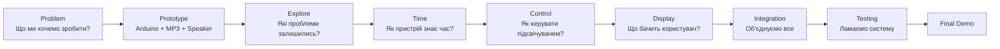
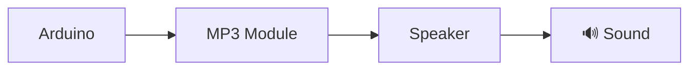
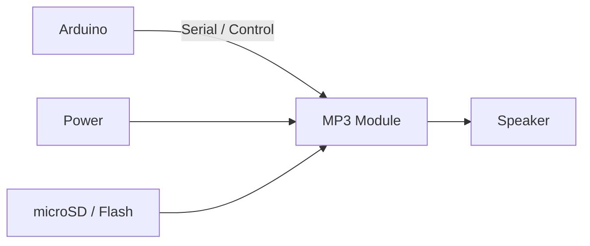
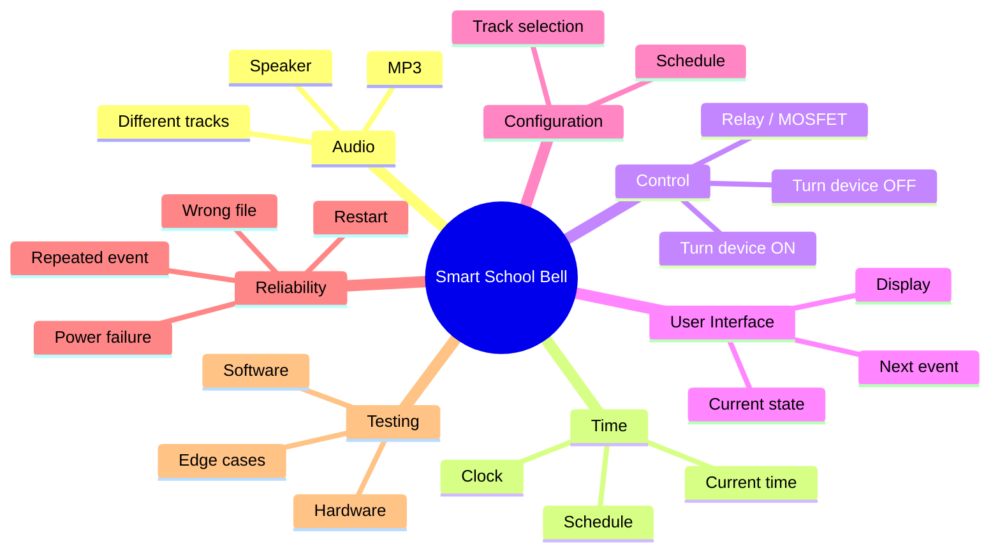
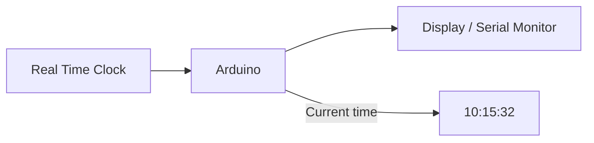
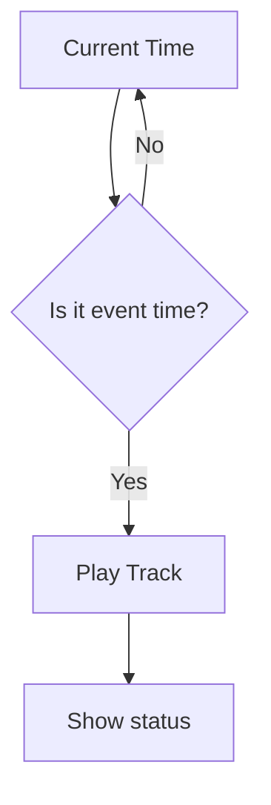
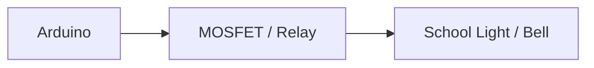
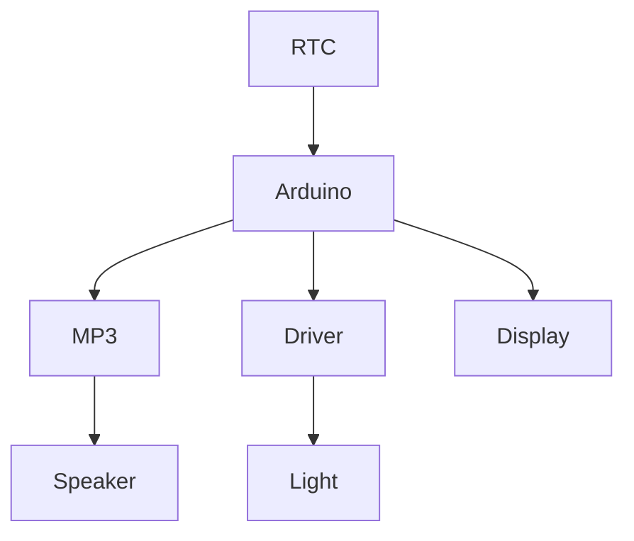
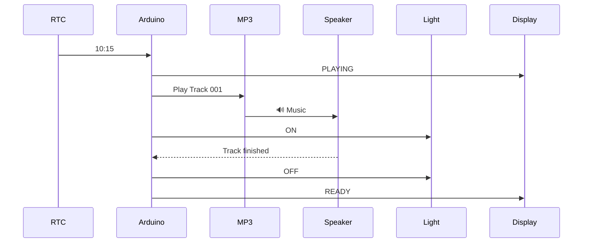
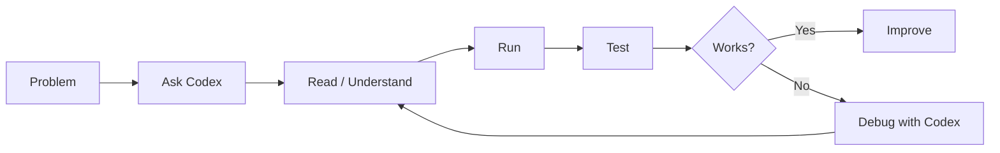

# STEM Project: Smart School Bell

## 1. Мета проєкту

Створити невеликий пристрій на базі **Arduino**, який у заданий час:

* вмикає шкільний підсвічувач / сигнал;
* запускає потрібний аудіотрек;
* відтворює звук через динамік;
* показує поточний стан на невеликому дисплеї.

Ми не починаємо з програмування.

Спочатку команда має **фізично змусити пристрій відтворити звук**.

Після цього поступово додаємо автоматизацію.

---

# 2. Як ми будемо працювати

Проєкт розділений на короткі етапи:



**Головний принцип:**

> Спочатку працюючий фізичний prototype, потім код і складніша логіка.

---

# 3. Командні ролі

Ролі не означають, що кожна дитина працює тільки зі своєю частиною.
Ролі потрібні, щоб кожен відповідав за певний аспект проєкту.

| Роль                      | Основна відповідальність                      |
| ------------------------- | --------------------------------------------- |
| 🧑‍💼 **Project Manager** | Backlog, задачі, порядок роботи, blockers     |
| 🔌 **Hardware Engineer**  | Arduino, MP3, speaker, wiring, soldering      |
| 💻 **Software Engineer**  | Код Arduino та інтеграція компонентів         |
| 🧪 **QA Engineer**        | Перевірка, пошук помилок, test cases          |
| 🎨 **Product / UX**       | Що має робити пристрій і що бачить користувач |

Якщо дітей мало — одна дитина може мати дві ролі.

---

# 4. Урок 1 — Make it speak 🔊

> Детальний сценарій на 90 хвилин, теорія, оцінювання й діагностика: [план уроку](../lessons/lesson-01-make-it-speak/lesson-plan.md). Слайди заняття: [презентація уроку](../lessons/lesson-01-make-it-speak/presentation.md). Технічна схема, скетч і стан перевірки: [папка уроку](../lessons/lesson-01-make-it-speak/).

## Mission

> **Підключити Arduino до MP3-модуля та динаміка і відтворити перший звук.**

Це єдина головна задача першого уроку.

Не треба поки що:

* RTC;
* дисплей;
* розклад;
* автоматичне включення;
* складний UI.

Ми повинні отримати:



## Частина 1 — Розібрати задачу

Короткий brainstorming:

**Що потрібно, щоб отримати звук?**

Діти самі повинні прийти до:

* Arduino;
* MP3 player/module;
* storage з аудіофайлом;
* speaker;
* power;
* wires.

---

## Частина 2 — Hardware

Показуємо компоненти.

Діти визначають:

* де живлення;
* де GND;
* де audio output;
* де control pins;
* куди підключається speaker.

Після цього робимо wiring.



---

## Частина 3 — Пайка

Мінімальна практична задача:

1. Зачистити дріт.
2. Залудити дріт.
3. Припаяти дріт до speaker.
4. Перевірити механічне з'єднання.
5. Перевірити коротке замикання.

### Правило

> Паяльник — тільки після пояснення правил безпеки і під контролем викладача.

На першому уроці не потрібно навчати дітей складній пайці.

Їм достатньо отримати досвід:

**wire → solder → component → working circuit**

---

## Частина 4 — Перше відтворення

Тут уже підключаємо Arduino і MP3 module.

Програмування робимо **за допомогою Codex**.

Діти не повинні просто отримати готовий код.

Завдання:

> «Попросіть Codex створити мінімальну Arduino-програму, яка запускає перший трек на MP3-модулі».

Після цього команда:

1. читає код;
2. дивиться, які pins використовуються;
3. завантажує код;
4. запускає;
5. слухає результат.

### Definition of Done — Lesson 1

* [ ] Arduino підключений.
* [ ] MP3 module підключений.
* [ ] Speaker припаяний.
* [ ] Аудіофайл знаходиться на storage.
* [ ] Arduino може керувати MP3 module.
* [ ] Через speaker чути звук.
* [ ] Команда розуміє базову схему.

**🎯 Результат уроку:**

> **Ми змусили машину заговорити.**

---

# 5. Наприкінці уроку — Brainstorming

Після першого успіху **не переходимо одразу до наступного компонента**.

Ставимо дітям питання:

> «Добре. Ми можемо програти музику. А тепер як перетворити це на шкільний пристрій? Що нам ще потрібно?»

На дошці створюємо:

## Open Problems

Наприклад:



**Це і є backlog наступних уроків.**

---

# 6. Урок 2 — Make it know the time ⏰

> Детальний сценарій, теорія та дві гілки практикуму (RTC обраний / ще не обраний): [план уроку](../lessons/lesson-02-know-the-time/lesson-plan.md). Слайди: [презентація уроку](../lessons/lesson-02-know-the-time/presentation.md). Модель RTC та інтерфейс ще не визначені.

## Mission

> Пристрій повинен знати, який зараз час.

Спочатку обговорюємо:

> «Як Arduino зараз може знати, що 10:15?»

Діти пропонують варіанти.

Потім вводимо **RTC module**.



### Результат

Arduino показує:

```text
Current time:
10:15:32
```

### Homework / challenge

> Як зробити так, щоб о 10:16 автоматично запустився Track 1?

---

# 7. Урок 3 — Make it automatic ⚙️

Тепер з'єднуємо дві речі:

**TIME + AUDIO**



Наприклад:

```text
10:15 → Play track 001
10:30 → Play track 002
11:15 → Play track 003
```

Тут з'являється справжня програмна логіка.

Діти разом із Codex розбираються:

* `if`;
* time comparison;
* schedule;
* functions;
* state;
* як не запускати один і той самий трек 100 разів.

---

# 8. Урок 4 — Керуємо підсвічувачем 💡

Тепер додаємо фізичне навантаження.



**Важливо:** для навчального прототипу спочатку використовуємо **LED або інше безпечне низьковольтне навантаження**.

Не підключаємо дітей до мережевої напруги.

Логіка:

```text
10:15
   ↓
Arduino
   ├── Play Track
   └── Turn Light ON
```

---

# 9. Урок 5 — Display / User Interface

Тепер пристрій повинен щось повідомляти користувачу.

Наприклад:

```text
SCHOOL SYSTEM

10:14

NEXT:
10:15 MUSIC
```

Під час запуску:

```text
▶ PLAYING

Track 001
```

Після завершення:

```text
READY

Next:
10:30
```

Діти вирішують:

* що показувати;
* які стани потрібні;
* які помилки показувати.

Це вже **Product + UX**, а не просто Arduino.

---

# 10. Урок 6 — Integration & QA 🧪

Тепер усі частини працюють разом.



QA отримує завдання:

> **Спробуйте зламати систему.**

### Test cases

| Scenario           | Expected                   |
| ------------------ | -------------------------- |
| Before event       | Nothing happens            |
| Event time         | Track starts               |
| Event time         | Light turns ON             |
| After event        | System returns to READY    |
| Restart Arduino    | System continues correctly |
| Missing MP3        | Error / safe behaviour     |
| Wrong track        | Error                      |
| Event occurs twice | Track plays only once      |
| Power interruption | System recovers            |

---

# 11. Фінальний результат

У кінці команда має продемонструвати:



## Final Demo

Команда задає тестовий час:

**10:15**

Система сама:

1. визначає час;
2. знаходить подію;
3. запускає потрібний трек;
4. включає підсвічувач;
5. показує статус;
6. завершує подію;
7. повертається у `READY`.

---

# 12. Backlog

## 🔊 Audio

* [ ] Identify MP3 module
* [ ] Prepare audio file
* [ ] Prepare SD / Flash
* [ ] Connect MP3 module
* [ ] Solder speaker
* [ ] Play first track
* [ ] Play selected track
* [ ] Handle missing track

## ⏰ Time

* [ ] Select RTC
* [ ] Connect RTC
* [ ] Read current time
* [ ] Display current time
* [ ] Create schedule

## 💡 Hardware Control

* [ ] Build safe low-voltage prototype
* [ ] Control LED/load
* [ ] Add MOSFET/relay if required
* [ ] Turn load ON
* [ ] Turn load OFF

## 🖥️ Display

* [ ] Connect display
* [ ] Show current time
* [ ] Show next event
* [ ] Show PLAYING state
* [ ] Show error state

## 💻 Software

* [ ] Arduino project setup
* [ ] MP3 control
* [ ] RTC control
* [ ] Schedule logic
* [ ] Event state
* [ ] Prevent repeated trigger
* [ ] Error handling

## 🧪 QA

* [ ] Create test cases
* [ ] Test audio
* [ ] Test time
* [ ] Test schedule
* [ ] Test output
* [ ] Test restart
* [ ] Test wrong/missing files
* [ ] Test repeated events

## 🧑‍💼 Project

* [ ] Define requirements
* [ ] Maintain backlog
* [ ] Assign tasks
* [ ] Track blockers
* [ ] Prepare final demo
* [ ] Prepare presentation

---

# 13. Definition of Done

Проєкт вважається готовим, коли команда може сказати:

> **"We built it, we understand it, and we tested it."**

Не просто:

> «Codex написав код, і воно працює».

А кожна дитина повинна бути здатна пояснити хоча б свою частину:

* що ми підключили;
* навіщо це потрібно;
* як частини спілкуються;
* що відбувається після настання потрібного часу;
* як ми перевіряємо, що система працює.

---

# 14. Головний принцип роботи з Codex

Codex використовується як **engineering assistant**, а не як «машина, яка робить проєкт за дітей».

Workflow:



Тому правильне питання для дітей:

> ❌ «Codex, зроби мені Arduino-проєкт».

А:

> ✅ «Ми використовуємо MP3-модуль ___, Arduino ___ і хочемо програти track 001 після натискання кнопки. Допоможи нам зрозуміти, як це підключити і написати мінімальний код. Поясни, що робить кожна частина».

Це дозволяє дітям **використовувати AI як інженерний інструмент**, але залишатися авторами рішення.
