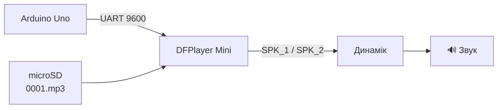

# Урок 1 — Make it speak 🔊

> **Mission:** підключити Arduino Uno до DFPlayer Mini та динаміка і відтворити перший звук.

Це єдина головна задача уроку. Поки що **не потрібні**: RTC, дисплей, розклад, автоматичне вмикання, складний UI.



> **Матеріали для проведення:** [повний план уроку](lesson-plan.md) (цілі, теорія, 90-хвилинний сценарій, оцінювання й діагностика) та [слайди презентації](presentation.md) (джерело Marp). Презентація проєкту в `artifacts/` описує весь пристрій, а не цей навчальний урок.

## Обладнання

| Компонент | Що потрібно | Статус |
| --- | --- | --- |
| Плата | Arduino Uno | підтверджено |
| MP3-модуль | DFPlayer Mini | підтверджено |
| microSD | FAT32, до 32 ГБ, файл `0001.mp3` | — |
| Динамік | 4–8 Ом, до 3 Вт | модель не визначена |
| Резистор | 1 кОм (лінія Uno D11 → RX DFPlayer) | — |
| Дроти, макетна плата | | — |

## Схема підключення


| Вивід DFPlayer Mini | Куди на Arduino Uno | Колір на схемі | Навіщо |
| --- | --- | --- | --- |
| 1 VCC | 5V | червоний | живлення модуля |
| 2 RX | D11 **через резистор R1 = 1 кОм** | помаранчевий | Uno надсилає команди |
| 3 TX | D10 | зелений | Uno приймає відповіді модуля |
| 6 SPK_1 і 8 SPK_2 | — (до динаміка) | сірий | звук; динамік 4–8 Ом, до 3 Вт |
| 7 GND **або** 10 GND | GND | чорний | спільна «земля» (обидва GND модуля з'єднані між собою) |
| 16 BUSY | D7 | фіолетовий | LOW = трек справді грає |

Виводи 4, 5, 9, 11–15 на першому уроці не підключаємо.

### Резистор R1 = 1 кОм

- Ставиться **в розрив дроту D11 → RX**: одна ніжка резистора — до D11, друга — до виводу 2 (RX) модуля. Не до GND і не паралельно.
- Як упізнати: смужки **коричнева – чорна – червона** (1 – 0 – ×100 = 1000 Ом), четверта золота — допуск ±5 %. Якщо сумніваєтесь — виміряйте мультиметром: має бути ≈ 1 кОм.
- Навіщо: вхід RX модуля розрахований на 3,3 В, а Uno видає 5 В. Резистор обмежує струм і зменшує шум у динаміку. На лінії TX → D10 резистор не потрібен.

### Як це виглядає у Wokwi

У Wokwi немає справжнього DFPlayer, тому емулятор показує лише потрібні виводи з підписами праворуч (`RX ← R1 ← D11`, `TX → D10` …), а над резистором стоїть напис `R1 = 1 кОм`. На справжньому модулі виводи розташовані як на малюнку вище.

**Зверніть увагу:**

- TX модуля → RX Arduino і навпаки — дроти «перехрещуються».
- Динамік підключаємо **тільки** до SPK_1/SPK_2. Не до GND.
- На великій гучності модуль може «просаджувати» живлення від USB. Якщо Uno перезавантажується або чути тріск — зменште `VOLUME` у скетчі.

## Підготовка microSD

1. Відформатуйте карту у FAT32.
2. Скопіюйте **один** файл і назвіть його `0001.mp3` (у корінь карти).
3. `play(1)` у DFPlayer означає «перший файл, записаний на карту», а не «файл з назвою 0001». Тому на першому уроці на карті — лише один трек.

## Хід уроку

### Частина 1 — Розібрати задачу (brainstorming)

**Що потрібно, щоб отримати звук?** Діти самі мають дійти до: Arduino, MP3-модуль, носій з аудіофайлом, динамік, живлення, дроти.

### Частина 2 — Hardware

Показуємо компоненти. Діти знаходять на DFPlayer Mini: живлення (VCC), GND, аудіовихід (SPK_1/SPK_2), контакти керування (RX/TX, BUSY), куди підключається динамік. Після цього збираємо схему за таблицею вище.

### Частина 3 — Пайка

1. Зачистити дріт.
2. Залудити дріт.
3. Припаяти дріт до динаміка.
4. Перевірити механічне з'єднання.
5. Перевірити, чи немає короткого замикання.

> ⚠️ Паяльник — тільки після пояснення правил безпеки і під контролем викладача.

Мета — досвід **wire → solder → component → working circuit**, а не складна пайка.

### Частина 4 — Перше відтворення (з Codex)

Завдання для команди:

> «Ми використовуємо DFPlayer Mini і Arduino Uno. Створи мінімальну програму, яка запускає перший трек. Поясни, що робить кожна частина і які піни використовуються».

Потім команда:

1. читає код ([`sketch/sketch.ino`](sketch/sketch.ino)) і порівнює його зі своєю відповіддю Codex;
2. знаходить у коді піни 10, 11, 7, 2;
3. завантажує скетч в Uno;
4. відкриває Serial Monitor (9600 бод);
5. слухає трек і перевіряє повідомлення про завершення.

### Що має бути в Serial Monitor

```text
Урок 1: Arduino Uno + DFPlayer Mini
Запуск DFPlayer...
DFPlayer готовий.
Файлів на SD: 1
Команда: відтворити трек 1
ГРАЄ: відтворення підтверджено (BUSY = LOW).
DFPlayer: трек завершився: 1
ГОТОВО: трек більше не грає.
```

### Якщо не грає

| Повідомлення | Що перевірити |
| --- | --- |
| `DFPlayer не відповідає або немає SD-карти` | TX/RX не переплутані? Є 5V і GND? Карта вставлена й у FAT32? |
| `на SD-карті немає треку з таким номером` | Чи є файл на карті |
| `трек не запустився (немає підтвердження BUSY)` | Дріт BUSY → D7; формат файлу MP3 |
| «ГРАЄ» є, а звуку немає | Пайка динаміка, SPK_1/SPK_2, гучність |

Скетч пише «ГРАЄ» лише тоді, коли модуль підтвердив відтворення сигналом BUSY. Сама команда `play()` ще не означає, що звук є.

## Збірка

- Arduino IDE: відкрити `sketch/sketch.ino`, плата **Arduino Uno**, у Library Manager встановити **DFRobotDFPlayerMini**.
- arduino-cli:

  ```sh
  arduino-cli lib install DFRobotDFPlayerMini
  arduino-cli compile --fqbn arduino:avr:uno --export-binaries lessons/lesson-01-make-it-speak/sketch
  ```

## Симуляція у Wokwi

У Wokwi немає готової деталі DFPlayer Mini, тому в папці [`wokwi/`](wokwi/) є навчальний **емулятор** (custom chip). Він не відтворює звук, але відповідає на команди як модуль, тримає BUSY = LOW під час «відтворення» і надсилає «трек завершився». Клікніть на чип у симуляторі, щоб змінити налаштування:

| Налаштування | Що імітує |
| --- | --- |
| `sdCard` = 0 | карту вийнято → скетч має показати помилку |
| `trackCount` = 0 | порожня карта → «немає треку» |
| `trackSeconds` | тривалість треку |

Динаміка в симуляції немає.

**На wokwi.com:**

1. Створіть проєкт Arduino Uno, вставте `sketch/sketch.ino` у `sketch.ino`.
2. Вставте [`wokwi/diagram.json`](wokwi/diagram.json) у `diagram.json`.
3. Library Manager → додайте `DFRobotDFPlayerMini`.
4. Стрілка ▾ праворуч від вкладок редактора → **New file…** → `dfplayer-mini.chip.json` і `dfplayer-mini.chip.c` — вставте вміст файлів з `wokwi/`.
5. Запустіть симуляцію.

**Wokwi CLI / MCP (локально):** [`wokwi/wokwi.toml`](wokwi/wokwi.toml) бере зібраний `.hex` з `sketch/build/` і `dfplayer-mini.chip.wasm`. Чип компілюється так (потрібен Docker; `wokwi-api.h` — з `https://wokwi.com/api/chips/wokwi-api.h`):

```sh
docker run --rm -v "$PWD:/src" -w /src wokwi/builder-clang-wasm:latest \
  clang --target=wasm32-unknown-wasi --sysroot /opt/wasi-libc -nostartfiles \
  -Wl,--import-memory -Wl,--export-table -Wl,--no-entry -Wno-unused-function \
  -o dfplayer-mini.chip.wasm dfplayer-mini.chip.c
```

## Definition of Done

- [ ] Arduino підключений.
- [ ] DFPlayer Mini підключений (через резистор 1 кОм на RX).
- [ ] Динамік припаяний.
- [ ] Аудіофайл знаходиться на microSD.
- [ ] Arduino може керувати DFPlayer (у Serial Monitor «DFPlayer готовий»).
- [ ] Через динамік чути звук.
- [ ] Команда розуміє базову схему і може пояснити, навіщо кожен дріт.

**🎯 Результат уроку:** _Ми змусили машину заговорити._

## Наприкінці уроку — Open Problems

Після першого успіху не переходимо одразу до наступного компонента. Питання до команди:

> «Добре. Ми можемо програти музику. А як перетворити це на шкільний пристрій? Що нам ще потрібно?»

На дошці складаємо карту проблем (Audio, Time, Control, User Interface, Configuration, Reliability, Testing) — це backlog наступних уроків. Див. [план курсу](../../dev/lessons.md#5-наприкінці-уроку--brainstorming).

## Стан перевірки

| Перевірка | Результат |
| --- | --- |
| Компіляція скетчу (arduino-cli, `arduino:avr:uno`, DFRobotDFPlayerMini 1.0.6) | ✅ успішно: 6696 Б flash (20%), 365 Б RAM (17%) |
| Компіляція емулятора в WASM (`wokwi/builder-clang-wasm`) | ✅ успішно, без попереджень |
| Запуск у симуляторі Wokwi ([проєкт](https://wokwi.com/projects/477331160511092737), `sdCard=1`, `trackCount=3`) | ✅ «DFPlayer готовий» → «Файлів на SD: 3» → «ГРАЄ: відтворення підтверджено» → «трек завершився: 1». Сценарії без SD-карти ще не перевірені |
| Перевірка на реальному Uno + DFPlayer Mini | ⏳ ще не виконано |
