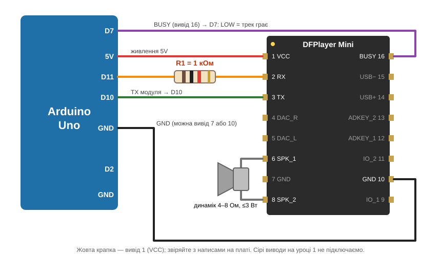

<!-- _class: cover -->
<!-- _paginate: false -->
<!-- _footer: "" -->

###### Рівень 01 · Аудіолаб STEM-93

# Змусь машину говорити

**Місія:** Arduino дає команду — ми чуємо перший звук. 🔊

<!--
Нотатки викладача: відкрийте урок із питання, а не з теорії. Перший звук — головна мета всього заняття.
-->

---

<!-- _class: quest -->

###### Розминка · 3 хвилини

# Що потрібно машині, щоб видати звук?

> Намалюйте шлях **від команди до ваших вух**. Помилятися можна — порівняємо версії за хвилину.

<!--
Зберіть 2–3 малюнки й залиште їх на дошці: до них повернемося на слайді з ланцюгом.
-->

---

<!-- _class: chain -->

###### Сьогоднішній ланцюг

# Від команди до звуку

1. **Arduino Uno** надсилає команду «грай трек 1»
2. **DFPlayer Mini** знаходить MP3 на microSD і декодує
3. **Динамік** перетворює сигнал на коливання повітря
4. **Звук** 🎉 доказ, що все спрацювало

Під час увімкнення Arduino Uno автоматично запускає **трек №1**. Розклад і точний час будуть на наступних рівнях.

---

<!-- _class: cards -->

###### Знайомтеся: наша команда

# Хто за що відповідає?

- **Arduino Uno** мозок: виконує програму й надсилає команди.
- **DFPlayer Mini** DJ: шукає трек, декодує MP3, видає аудіосигнал.
- **microSD** фонотека: зберігає аудіофайли.
- **Динамік** голос: перетворює сигнал на звук.

> 🤔 Чи надсилає Arduino саму музику по UART?

---

<!-- _class: theory -->

###### Теорія · 1

# UART — розмова двох плат

- Дані йдуть **послідовно**, біт за бітом.
- Лінії перехресні: **TX** одного → **RX** іншого.
- У нашому скетчі Arduino слухає на **D10** (RX), а говорить через **D11** (TX).
- Обидві плати домовляються про швидкість: `9600` бод.

> UART везе **команди й відповіді**, а не музику. Звук іде окремим шляхом: з аудіовиходу DFPlayer до динаміка.

---

<!-- _class: theory -->

###### Теорія · 2

# `play(1)` — це прохання, а не доказ

Команда лише **просить** запустити трек. Чи він справді грає, перевіряємо трьома рівнями доказу:

1. модуль **відповів** на запуск;
2. лінія **BUSY → D7** стала `LOW` (трек грає);
3. ми **чуємо** звук у динаміку.

### 🕵️ Звуку немає. Що перевіриш першим?

---

<!-- _class: lab -->

###### Практика · збирання

# Збираємо без поспіху

1. Перепідключаємо тільки **знеструмлену** схему.
2. Звіряємо кожен контакт зі схемою уроку.
3. Спільний **GND**, а TX/RX навхрест.
4. Перед живленням напарник перевіряє стенд.
5. Сумніваєшся в компоненті чи напрузі? **Стоп**, кличемо викладача.

---

<!-- _class: lab -->

###### Детектив коду

# Прочитай програму до запуску

Знайди у `sketch/sketch.ino`:

- де задані контакти `D10`, `D11`, `D7`;
- де стартує зв'язок із DFPlayer;
- де надсилається команда відтворення;
- де код перевіряє BUSY і повідомляє про помилку.

### 🔮 Передбач: що покаже Serial Monitor?

---

<!-- _class: lab -->

###### Експеримент

# Запускаємо й записуємо факти

| Джерело | Що перевіряємо | Що побачили? |
| --- | --- | --- |
| Serial Monitor | модуль, файл, повідомлення | |
| BUSY (D7) | `LOW` під час відтворення? | |
| Динамік | звук чути? | |

> Скетч завантажився ≠ система **довела**, що звук відтворюється.

---

<!-- _class: alert -->

###### Режим налагодження

# Щось мовчить? Шукаємо причину

| Симптом | Перевір |
| --- | --- |
| Модуль не відповідає | живлення, GND, TX/RX, швидкість |
| Трек не знайдено | microSD, файл, номер треку |
| BUSY не активний | контакт BUSY, результат запуску |
| BUSY активний, а тиша | аудіовихід, дроти динаміка, гучність |

**Правило:** одна можлива причина за раз. Wokwi перевіряє логіку, але справжнього звуку не видає.

---

<!-- _class: win -->
<!-- _paginate: false -->

###### 🏆 Досягнення розблоковано

# Ми змусили машину говорити

Тепер кожна команда пояснює: **який доказ показує, що вона справді говорить?**

---

<!-- _class: levels -->

###### Наступні рівні 🔒

# Чого ще бракує шкільному плеєру?

- ⏰ Як пристрій дізнається час і не забуває його після вимкнення?
- ⚙️ Як запустити потрібний трек рівно один раз за розкладом?
- 💡 Чим безпечно керувати шкільним навантаженням?
- 🖥️ Що має бачити людина на екрані?
- 🧪 Як система повідомляє про помилку й відновлюється?

Це **відкриті рішення**. Розкриваємо їх на наступних уроках.

---

<!-- _class: ticket -->

###### Вихідний квиток 🎟️

# Три питання перед виходом

1. Які дані йдуть через UART? А звідки береться звук?
2. Чому після `play(1)` ще рано писати «ГРАЄ»?
3. Яку одну проблему треба вирішити, щоб запуск був за розкладом?

### 🏠 Вдома: намалюй шлях час → рішення → аудіо

Пунктиром познач усе, що ще не обрано або не реалізовано.
