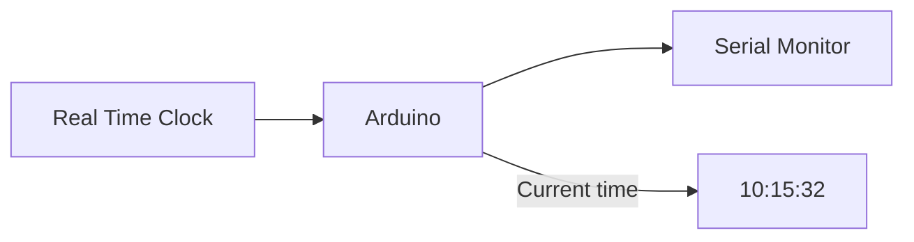

# Урок 2 — Make it know the time ⏰

> **Mission:** пристрій повинен знати, який зараз час.

> Повний сценарій, теорія, оцінювання та варіанти проведення: [план уроку](lesson-plan.md). Навчальні слайди: [презентація](presentation.md).

## Обладнання

| Компонент | Статус |
| --- | --- |
| Arduino Uno + DFPlayer Mini з уроку 1 | підтверджено |
| RTC-модуль | **модель не визначена** — обрати перед апаратним практикумом (інтерфейс, живлення, батарейка) |
| OLED | **модель не визначена** — це окремий етап курсу; інтерфейс сумісності перевірити після вибору |

Піни RTC/OLED, бібліотеки, адреси й схему додамо лише після вибору конкретних модулів та перевірки сумісності. У цьому уроці час показуємо через Serial Monitor, не через OLED.

## Хід уроку

1. Обговорення: «Як Arduino зараз може знати, що 10:15?» Діти пропонують варіанти (лічити `millis()`, інтернет, годинник з батарейкою…). Що буде після вимкнення живлення?
2. Знайомство з RTC (Real Time Clock).
3. Практична гілка залежить від готовності обладнання: з перевіреним RTC — підключення, встановлення та читання часу за схемою його виробника; без обраного RTC — аналіз вимог і план перевірки, без вигаданих пінів/бібліотек.
4. Вивід часу в Serial Monitor.



## Результат

```text
Current time:
10:15:32
```

Якщо RTC недоступний — програма має повідомити про помилку, а не показувати вигаданий час.

## Homework / challenge

> Як зробити так, щоб о 10:16 автоматично запустився Track 1?

## Definition of Done

- [ ] RTC обрано і підключено.
- [ ] Час встановлено і читається.
- [ ] Час виводиться в Serial Monitor щосекунди без `delay()`.
- [ ] Відсутній/несправний RTC дає зрозуміле повідомлення про помилку.
