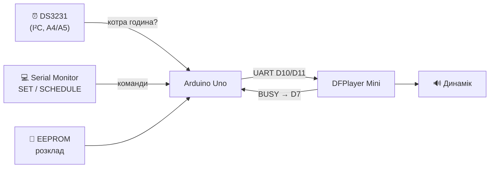
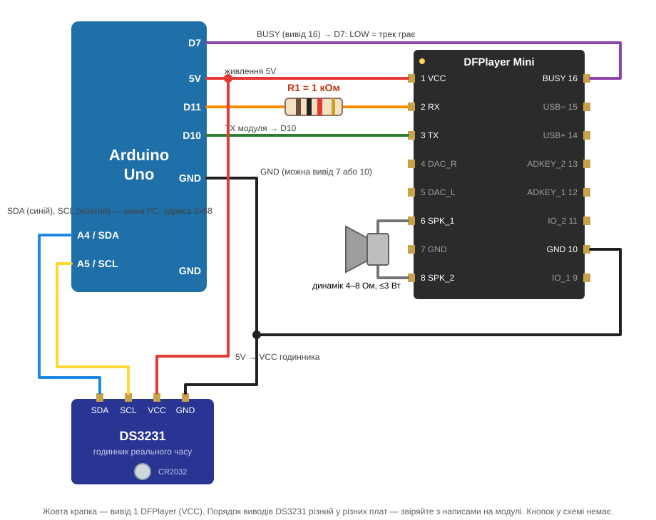

# Урок 2 — Make it know the time ⏰

> **Mission:** пристрій знає, котра година, і **сам** вмикає шкільний розклад: 09:00 хвилина мовчання → 09:01 гімн → 12:10 цитата дня.

> Повний сценарій і теорія: [план уроку](lesson-plan.md). Сторінка-презентація для класу: [presentation.html](presentation.html).

Урок 2 — пряме продовження [уроку 1](../lesson-01-make-it-speak/): схема Uno + DFPlayer Mini + динамік не змінюється, ми лише **додаємо годинник DS3231** на чотири дроти. Перевіряємо все в симуляторі **Wokwi**.



## Обладнання

| Компонент | Статус |
| --- | --- |
| Arduino Uno + DFPlayer Mini + динамік (урок 1) | підтверджено, урок 1 завершено |
| RTC | **DS3231** — підтверджено (I²C, адреса 0x68), батарейка CR2032 |
| Кнопки | **немає** — керуємо командами з Serial Monitor |
| Дисплей | ще не обрано (урок 5); час показуємо в Serial Monitor |

## Схема підключення



Дроти уроку 1 **не чіпаємо**. Додаємо:

| Вивід DS3231 | Куди на Arduino Uno | Колір | Навіщо |
| --- | --- | --- | --- |
| VCC | 5V | червоний | живлення годинника |
| GND | GND | чорний | спільна «земля» |
| SDA | A4 (SDA) | синій | дані I²C |
| SCL | A5 (SCL) | жовтий | такт I²C |

Виводи 32K і SQW не підключаємо. Порядок виводів у різних плат DS3231 різний — дивіться на написи на модулі.

> ⚠️ **Батарейка.** На поширених платах DS3231 (часто з маркуванням ZS-042) стоїть схема підзаряджання, розрахована на акумулятор LIR2032. Якщо в модулі звичайна CR2032, перед заняттям уточніть у документації вашої плати, чи треба вимкнути підзаряджання. Це вирішує викладач — не учні.

Зайняті піни після уроку 2: D7 (BUSY), D10/D11 (DFPlayer), A4/A5 (I²C). Майбутній OLED-дисплей з I²C (картка Анни в Trello) зможе сісти на ту саму шину A4/A5, якщо його адреса не 0x68. Це ще треба перевірити.

## Шкільний розклад

| # | Час | Трек | Що звучить |
| --- | --- | --- | --- |
| 1 | 09:00 | 2 (`0002.mp3`) | хвилина мовчання |
| 2 | 09:01 | 1 (`0001.mp3`) | гімн України |
| 3 | 12:10 | 3 (`0003.mp3`) | цитата дня (велика перерва) |

Нумерація файлів — з картки US-5 у Trello.

**Де живе розклад.** Розклад зберігається в **EEPROM** разом із датою останнього запуску кожної події. Поки що його записує функція `setupSchedule()` у `setup()` з таблиці `SCHEDULE_FROM_CODE` на початку скетчу:

```cpp
const EventConfig SCHEDULE_FROM_CODE[] = {
  { 9,  0, 2},  // 09:00 — хвилина мовчання
  { 9,  1, 1},  // 09:01 — гімн України (після хвилини мовчання)
  {12, 10, 3},  // 12:10 — цитата дня, велика перерва
};
```

- Щоб змінити розклад зараз — виправте таблицю і завантажте скетч. `setupSchedule()` побачить різницю й перепише EEPROM.
- Якщо розклад у коді не змінювався, EEPROM не перезаписується, тож дати запусків зберігаються і подія не повториться після RESET.
- Пізніше розклад налаштовуватиметься ззовні (команди / застосунок) і записуватиметься в ту саму EEPROM. Тоді виклик `setupSchedule()` приберемо.

**Якщо трек ще грає.** Хвилина мовчання може тривати довше 60 секунд. Тоді о 09:01 гімн не перебиває її, а стає в чергу і стартує одразу, щойно BUSY покаже, що плеєр звільнився.

## Як керувати: команди в Serial Monitor

Відкрийте Serial Monitor (9600 бод, закінчення рядка «Новий рядок»/Newline) і надрукуйте:

| Команда | Що робить |
| --- | --- |
| `SET 2026-10-16 08:59:55` | встановити годинник (дата й час) |
| `SCHEDULE` | показати розклад з EEPROM і дати останніх запусків |
| `NOW` | показати час один раз |
| `PLAY` / `PLAY 2` | зіграти трек вручну (перевірка звуку) |
| `STOP` | зупинити (і скасувати подію в черзі) |
| `CLOCK OFF` / `CLOCK ON` | вимкнути / ввімкнути друк часу щосекунди |
| `HELP` | список команд |

## Демо «Ранкова лінійка»

```text
SET 2026-10-16 08:59:57
```

Очікуваний вивід (перевірено у Wokwi; емулятор DFPlayer «грає» кожен трек 5 с):

```text
Розклад із коду записано в EEPROM.
Розклад (EEPROM), подій: 3
  1) 09:00 → трек 2
  2) 09:01 → трек 1
  3) 12:10 → трек 3
...
Годинник встановлено: 2026-10-16 08:59:57
Час: 2026-10-16 08:59:59 | до події 1: 00:00:01
⏰ НАСТАВ ЧАС ПОДІЇ 1) 09:00 → трек 2
Команда: відтворити трек 2
ГРАЄ: відтворення підтверджено (BUSY = LOW).
...
ГОТОВО: трек більше не грає.
DFPlayer: трек завершився: 2
```

Потім `SET 2026-10-16 09:00:57` — гімн, `SET 2026-10-16 12:09:57` — цитата. Повторити ранок можна лише «наступного дня»: `SET 2026-10-17 08:59:57`.

Рядки «ГОТОВО» і «трек завершився» можуть приходити в будь-якому порядку: BUSY іноді гасне раніше, ніж DFPlayer надсилає своє повідомлення. Це нормально.

**Черга** (у Wokwi клацніть на DFPlayer і поставте `trackSeconds = 70`, потім `SET 2026-10-16 08:59:58`):

```text
⏰ НАСТАВ ЧАС ПОДІЇ 1) 09:00 → трек 2
ГРАЄ: відтворення підтверджено (BUSY = LOW).
⏰ НАСТАВ ЧАС ПОДІЇ 2) 09:01 → трек 1
Плеєр зайнятий — подія чекає, поки завершиться поточний трек.
ГОТОВО: трек більше не грає.
З черги: подія 2) 09:01 → трек 1
Команда: відтворити трек 1
ГРАЄ: відтворення підтверджено (BUSY = LOW).
```

### Якщо щось не так

| Повідомлення | Що перевірити |
| --- | --- |
| `годинник DS3231 не відповідає` | SDA→A4, SCL→A5 (не переплутані?), 5V, GND |
| `час не встановлено або збився` | батарейка; виконайте `SET …` |
| `DFPlayer недоступний` | схема уроку 1, SD-карта |
| подія не спрацювала | `SCHEDULE` — чи той час і чи не було вже запуску сьогодні? `NOW` — чи йде годинник? |

## Збірка

- Arduino IDE: відкрити `sketch/sketch.ino`, плата **Arduino Uno**, Library Manager → **DFRobotDFPlayerMini** і **RTClib** (Adafruit; разом з нею встановиться Adafruit BusIO).
- arduino-cli:

  ```sh
  arduino-cli lib install DFRobotDFPlayerMini RTClib
  arduino-cli compile --fqbn arduino:avr:uno --export-binaries lessons/lesson-02-know-the-time/sketch
  ```

## Симуляція у Wokwi

У Wokwi немає деталі DS3231, тому в [`wokwi/diagram.json`](wokwi/diagram.json) стоїть **DS1307**: у неї та сама адреса 0x68 і ті самі регістри часу, тож код для DS3231 читає й встановлює час без змін. Температуру та будильники самого DS3231 симулятор не імітує (ми їх і не використовуємо). DFPlayer — той самий емулятор, що в уроці 1.

> Годинник у Wokwi стартує з часом **UTC** (для Києва це мінус 3 години). Тому першою командою завжди `SET`.

**Проєкт уроку 2 на wokwi.com:** https://wokwi.com/projects/477985449630706689

Як його зібрати з нуля (на основі [проєкту уроку 1](https://wokwi.com/projects/477331160511092737)):

1. Відкрийте проєкт уроку 1 → **Save a copy** (щоб урок 1 лишився як був).
2. Замініть вміст `sketch.ino` на [`sketch/sketch.ino`](sketch/sketch.ino).
3. Замініть вміст `diagram.json` на [`wokwi/diagram.json`](wokwi/diagram.json). Додадуться годинник і 4 дроти.
4. Library Manager → додайте `RTClib` (DFRobotDFPlayerMini вже є).
5. Файли `dfplayer-mini.chip.*` лишаються з уроку 1.
6. ▶ Запуск → у Serial Monitor: `SET 2026-10-16 08:59:57`.

**Wokwi CLI / MCP (локально):** [`wokwi/wokwi.toml`](wokwi/wokwi.toml) бере `.hex` з `sketch/build/`. Емулятор DFPlayer компілюється так само, як в уроці 1.

## Definition of Done

- [ ] DS3231 підключено чотирма дротами, урок 1 працює як раніше.
- [ ] `SET` встановлює час, Serial Monitor показує його щосекунди без `delay()`.
- [ ] Розклад з трьох подій записано в EEPROM (`SCHEDULE` його показує), і в потрібну хвилину трек запускається **сам**.
- [ ] Кожна подія спрацьовує один раз: повторний `SET` на ту саму хвилину не запускає трек вдруге.
- [ ] Якщо трек ще грає, наступна подія чекає в черзі, а не перебиває його.
- [ ] Без годинника — зрозуміла помилка, і нічого не грає у випадковий час.
- [ ] Команда пояснює: що таке RTC, навіщо батарейка, чим I²C відрізняється від UART.

## Стан перевірки

| Перевірка | Результат |
| --- | --- |
| Компіляція (arduino-cli, `arduino:avr:uno`, DFRobotDFPlayerMini 1.0.6, RTClib 2.1.4) | ✅ 17 074 Б flash (52 %), 780 Б RAM (38 %), без попереджень |
| Wokwi CLI 0.28.1: розклад | ✅ при старті розклад записано в EEPROM; 09:00 → трек 2, 09:01 → трек 1, 12:10 → трек 3, кожен з «ГРАЄ» після BUSY = LOW |
| Wokwi: повторний `SET 08:59:58` після спрацювання | ✅ подія 1 спрацювала один раз |
| Wokwi: `trackSeconds = 70` (хвилина мовчання довша за хвилину) | ✅ подія 09:01 стала в чергу і стартувала після «ГОТОВО» |
| Wokwi: без годинника в схемі | ✅ «годинник DS3231 не відповідає», `SET` відхилено, нічого не грає |
| Wokwi: `sdCard = 0` | ✅ у час події — «DFPlayer недоступний», «ГРАЄ» не показано |
| Збереження EEPROM після вимкнення живлення | ⏳ Wokwi не зберігає EEPROM між запусками — перевірити на залізі |
| Перевірка на реальному Uno + DS3231 | ⏳ ще не виконано |
