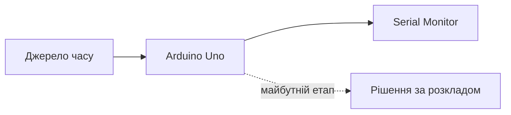

<!-- _class: dark -->
<!-- _paginate: false -->

###### STEM-93 · урок 2

# Як пристрій дізнається час? ⏰

**Місія:** знайти надійне джерело часу та навчитися помічати, коли йому не можна довіряти.

---

## Згадайте урок 1

Ми можемо дати команду DFPlayer і почути трек.

### А як сказати Arduino, що запуск потрібен саме о 10:15?

---

## Це секундомір чи годинник?

- **Секундомір:** скільки часу минуло від старту?
- **Годинник:** яка зараз дата й година?

Arduino може рахувати час від свого запуску. Але після вимкнення цей відлік починається знову.

---

## Що потрібно системі?

Сьогодні вивчаємо джерело часу. Розклад — наступний крок.

---

## RTC — годинник для пристрою

**RTC** веде календарний час окремо від основного циклу програми.

- Деякі модулі мають резервне живлення, щоб продовжувати відлік.
- Батарейка не живить усю Arduino.
- Точність і спосіб налаштування залежать від конкретної моделі.

Модель нашого RTC ще не обрана.

---

## Інші джерела часу

| Джерело | Що треба врахувати |
| --- | --- |
| RTC-модуль | Модель, сумісність, налаштування, резервне живлення |
| Мережа | Потрібне сумісне мережеве обладнання та з'єднання |
| Ручне встановлення | Хто й коли виправляє годинник? |

Який варіант продовжить працювати без мережі?

---

## UART та I²C — різні способи зв'язку

- **DFPlayer у нашому проєкті:** UART, окремі TX/RX для команд.
- **Деякі RTC та OLED:** можуть мати I²C, спільні SDA/SCL.
- Точний інтерфейс залежить від обраної моделі.

Якщо RTC та OLED підтримують сумісний I²C, вони можуть ділити шину — після перевірки адрес і електричних параметрів.

---

## Чому поки не малюємо піни?

Ми ще не знаємо модель RTC чи OLED.

Перед схемою треба перевірити:

1. точну модель і розводку;
2. інтерфейс;
3. живлення та сумісність з Uno;
4. адресу й бібліотеку, якщо це I²C.

**Спершу документація — потім підключення.**

---

## Як має поводитись надійна програма?

1. Запустити джерело часу.
2. Перевірити, чи воно відповідає.
3. Прочитати дату та час.
4. Переконатися, що значення встановлено й правдоподібне.
5. Показати час або чітке повідомлення про помилку.

Якщо RTC недоступний, не вигадуємо час.

---

## Практикум: оберіть свою гілку

### RTC вже обраний і перевірений

Працюйте за схемою та документацією саме цієї моделі; спостерігайте час у Serial Monitor.

### RTC ще не обраний

Складіть вимоги й тест-кейси, напишіть псевдокод. Позначте апаратне підключення як відкрите рішення.

**В обох випадках:** запишіть «очікували / побачили / висновок».

---

## Перевіряємо крайові випадки

| Ситуація | Що має зробити пристрій? |
| --- | --- |
| RTC відповідає й час перевірено | Показати поточний час |
| RTC не відповідає | Показати помилку, не вигадувати час |
| RTC є, але час не встановлений | Позначити час як неперевірений |
| RTC ще не обраний | Виконати лише проєктування/симуляцію |

---

<!-- _class: dark -->

## Міст до уроку 3

# Час ми маємо. Що робити далі?

Наступне завдання: порівняти поточний час із подіями розкладу й запустити потрібний трек **один раз**.

---

## Вихідний квиток

1. Чому `millis()` не знає, що зараз 10:15?
2. Що батарейка RTC підтримує — і чого не гарантує?
3. Чому ми ще не записали піни RTC та OLED?

### Домашній виклик

Намалюй стани **ЧАС ПЕРЕВІРЕНО**, **ЧАС НЕ ВСТАНОВЛЕНО**, **ДЖЕРЕЛО НЕДОСТУПНЕ**. Що має побачити користувач або технік у кожному стані?
