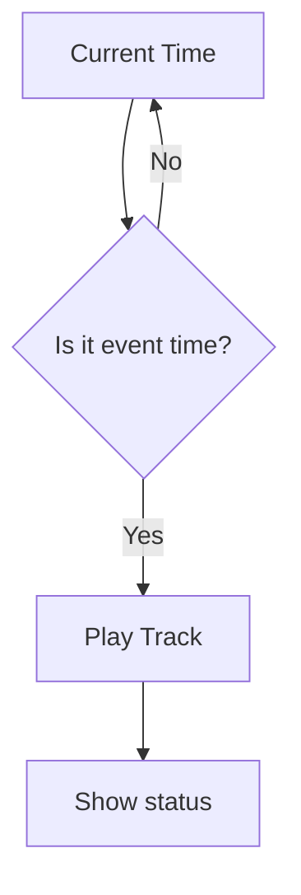

# Урок 3 — Make it automatic ⚙️

> **Mission:** з'єднати **TIME + AUDIO** — трек запускається сам у заданий час.

## Обладнання

Те саме, що на уроках 1–2 (Arduino Uno, DFPlayer Mini, DS3231). Нових компонентів немає.

> Урок 2 уже має розклад з трьох подій в EEPROM, захист від повтору і чергу (див. [`lesson-02-know-the-time/sketch`](../lesson-02-know-the-time/sketch/sketch.ino)). Поки що розклад записує в EEPROM функція `setupSchedule()` з таблиці в коді. **Урок 3 — налаштування розкладу ззовні**, без перепрошивки: команди в Serial Monitor (а згодом застосунок) змінюють події прямо в EEPROM.

## Логіка



Розклад школи (нумерація файлів — з картки US-5):

```text
09:00 → трек 2  хвилина мовчання
09:01 → трек 1  гімн України (чекає в черзі, якщо хвилина мовчання ще грає)
12:10 → трек 3  цитата дня, велика перерва
```

## Що розбираємо разом із Codex

- як влаштований розклад в EEPROM (`Settings`, `ScheduleEvent`) з уроку 2;
- команди для зміни подій без перепрошивки (додати / змінити / вимкнути);
- перевірка введення **до** запису в EEPROM (час, номер треку, кількість подій);
- коли прибрати `setupSchedule()`, щоб вона не перезаписувала налаштування з команд;
- ресурс EEPROM: писати лише змінені дані.

Головний цикл має залишатися неблокувальним: команди з Serial Monitor (кнопок у схемі немає) повинні оброблятися й під час очікування події.

## Definition of Done

- [ ] Подію можна змінити командою, і після RESET зміна зберігається.
- [ ] Неправильне введення не потрапляє в EEPROM.
- [ ] У потрібну хвилину трек запускається один раз; «Грає» — лише після BUSY.
- [ ] Команди Serial Monitor працюють під час очікування.
