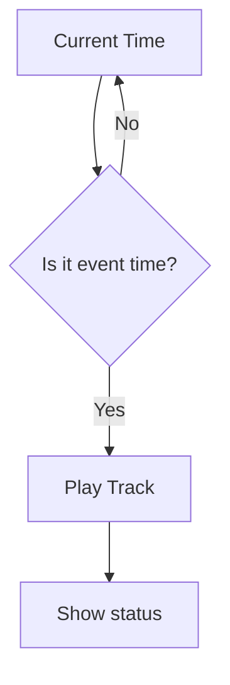

# Урок 3 — Make it automatic ⚙️

> **Mission:** з'єднати **TIME + AUDIO** — трек запускається сам у заданий час.

## Обладнання

Те саме, що на уроках 1–2 (Arduino Uno, DFPlayer Mini, RTC). Нових компонентів немає.

## Логіка



Приклад розкладу:

```text
10:15 → Play track 001
10:30 → Play track 002
11:15 → Play track 003
```

## Що розбираємо разом із Codex

- `if` і порівняння часу;
- розклад як масив подій;
- функції;
- стан (state);
- **як не запускати один і той самий трек 100 разів** за одну хвилину.

Головний цикл має залишатися неблокувальним: кнопка з уроку 1 повинна реагувати й під час очікування події.

## Definition of Done

- [ ] Розклад з 2–3 подій записаний у коді.
- [ ] У потрібну хвилину трек запускається один раз.
- [ ] «Грає» показується лише після підтвердження BUSY.
- [ ] Кнопка працює під час очікування.
