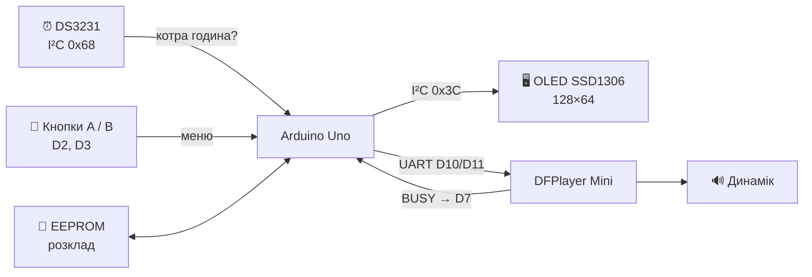
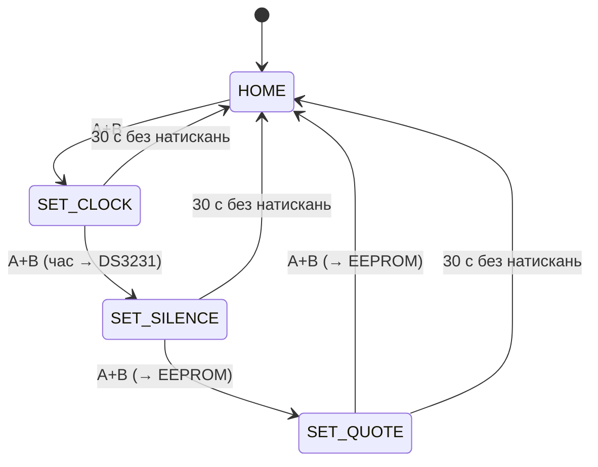
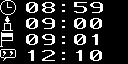
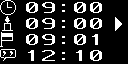
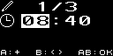
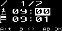

# Урок 3 — Make it show & listen 👀

> **Mission:** пристрій **показує** на OLED-дисплеї поточний час і розклад, а **поточний час**, час хвилини мовчання та цитати дня можна змінити **двома кнопками**, без комп'ютера і без перепрошивки.

> Сторінка-презентація для класу: [presentation.html](presentation.html).

Урок 3 продовжує [урок 2](../lesson-02-know-the-time/). Дроти DFPlayer і DS3231 лишаються як були, нового додаємо небагато: дисплей на ту саму шину I²C (A4/A5) і дві кнопки на D2/D3.



## Обладнання

| Компонент | Статус |
| --- | --- |
| Arduino Uno + DFPlayer Mini + динамік (урок 1) | підтверджено |
| DS3231 (урок 2) | підтверджено, I²C 0x68 |
| Дисплей | **OLED 0.96" SSD1306, 128×64, I²C** — обрано для уроку 3 (дослідження Анни в Trello). Адреса за замовчуванням **0x3C** |
| Кнопки | **2 тактові кнопки** без фіксації, на D2 і D3, другий вивід → GND |

> ⚠️ **Перевірте свій модуль, перш ніж підключати.**
> - **Контролер.** OLED на 1.3" часто має контролер **SH1106**, а не SSD1306. Тоді в скетчі змініть рядок дисплея на `U8X8_SH1106_128X64_NONAME_HW_I2C`.
> - **Адреса.** Деякі модулі мають адресу 0x3D (перемичка на звороті). Тоді змініть `OLED_I2C_ADDRESS` і передайте адресу в бібліотеку (`oled.setI2CAddress(0x3D * 2)`).
> - **Живлення.** Багато модулів приймають 3.3–5 В, але не всі. Дивіться напис біля виводу VCC на платі або документацію продавця. Що саме у вас — поки **не перевірено**.

## Схема підключення

Дроти уроків 1–2 **не чіпаємо**. Додаємо:

| Звідки | Куди на Arduino Uno | Навіщо |
| --- | --- | --- |
| OLED SDA | A4 (SDA) — разом із DS3231 | дані I²C |
| OLED SCL | A5 (SCL) — разом із DS3231 | такт I²C |
| OLED VCC | 5V (див. попередження вище) | живлення |
| OLED GND | GND | спільна «земля» |
| Кнопка A «+», вивід 1 | D2 | |
| Кнопка A «+», вивід 2 | GND | |
| Кнопка B «→», вивід 1 | D3 | |
| Кнопка B «→», вивід 2 | GND | |

У кнопки з чотирма ніжками попарно з'єднані протилежні ніжки. Беріть два виводи **по діагоналі**, тоді точно не помилитесь.

Резистори для кнопок не потрібні: скетч вмикає вбудовану підтяжку `INPUT_PULLUP`.

**Зайняті піни після уроку 3:** D2, D3 (кнопки), D7 (BUSY), D10/D11 (DFPlayer), A4/A5 (I²C: годинник 0x68 + дисплей 0x3C).

## Теорія

### OLED: кожен піксель — маленька лампочка

- **OLED** (Organic LED) не має підсвічування: світяться самі пікселі. Звідси глибокий чорний, контраст і мале споживання.
- **128×64 = 8 192 пікселі.** Кожен або світиться, або ні, тобто це 1 біт. Разом 8 192 / 8 = **1 024 байти**.
- **Пам'ять Uno — лише 2 048 байт RAM.** Бібліотека Adafruit SSD1306 тримає копію всього екрана в RAM, і це половина пам'яті. Анна з'ясувала це у своєму дослідженні, тож ми беремо **U8x8** (частина бібліотеки U8g2). Вона пише літери прямо в дисплей, без копії.
- U8x8 ділить екран на **16 × 8 клітинок** по 8×8 пікселів. Великі цифри займають 2×2 клітинки, іконка — теж 2×2 (16×16 пікселів).
- Шрифти U8x8 **не мають кирилиці**, тому замість слів на екрані **іконки**: годинник, свічка (хвилина мовчання), прапор (гімн), хмаринка з лапками (цитата). Усі іконки — у файлі [`sketch/icons.h`](sketch/icons.h), кожна намальована прямо в коментарі з `#`.
- Ми перемальовуємо **лише ті рядки, що змінилися**. Так менше даних іде по I²C, і екран не блимає.

### I²C: одна шина — багато пристроїв

Дисплей і годинник сидять на тих самих двох дротах A4/A5. Кожен пристрій має свою **адресу**: DS3231 — `0x68`, OLED — `0x3C`. Arduino звертається до кожного за адресою, як листоноша до будинку. Скетч на старті перевіряє, чи відповідає пристрій за адресою `0x3C`. Якщо ні, у Serial Monitor з'являється зрозуміла помилка, а плеєр працює далі без екрана.

### Кнопка: просто два дроти, які торкаються

- `INPUT_PULLUP`: усередині Uno пін з'єднаний через резистор ~20–50 кОм з 5 В. Кнопку не натиснуто — пін читає `HIGH`. Натиснули — пін з'єднується з GND і читає `LOW`. **Натиснуто = LOW.**
- **Брязкіт контактів (bounce).** Механічний контакт кілька мілісекунд «підстрибує»: LOW-HIGH-LOW-HIGH. Без захисту одне натискання дає кілька. **Антибрязкіт:** зміну приймаємо, лише якщо пін не змінювався 30 мс.
- **Комбінація A+B.** Пальці ніколи не натискають дві кнопки в одну мікросекунду. Тому одиночну дію («+1», «→») виконуємо **на відпусканні**. Якщо за час натискання друга кнопка теж опинилась внизу, це «A+B», і одиночна дія не спрацьовує.
- **Утримання «+»** понад 0,6 с — значення біжить саме (кожні 150 мс).
- Жодного `delay()`: кнопки, плеєр і розклад працюють одночасно.

### Меню як скінченний автомат (state machine)



Змінна `uiMode` пам'ятає, де ми зараз, і та сама кнопка робить різне залежно від стану.

### Де що зберігається

| Що | Де | Чому переживає вимкнення |
| --- | --- | --- |
| **Поточний час** (меню 1/3 або `SET`) | у годиннику **DS3231** (`rtc.adjust()`) | батарейка CR2032 живить годинник |
| **Розклад** (меню 2/3 і 3/3) | в **EEPROM** Arduino | EEPROM не стирається без живлення |

У меню 1/3 час записується в годинник, лише якщо ви натискали «+» (або годинник ще не знав часу). Якщо просто пройти далі — запис не робиться, і секунди не обнуляються. Секунди після запису = 00. Дата лишається та, що в годиннику; якщо годинник дати не знав — ставиться 2026-01-01, точну дату задає команда `SET`.

### Розклад тепер живе в EEPROM «по-справжньому»

В уроці 2 функція `setupSchedule()` при кожному старті переписувала розклад з коду. Тепер її **прибрано**. Розклад з коду (09:00 / 09:01 / 12:10) записується лише тоді, коли EEPROM порожня або має формат уроку 2. Далі розклад змінюють кнопки, і після RESET зміни зберігаються.

- **Гімн іде за хвилиною мовчання:** його час завжди = час мовчання + 1 хв. Окремого меню для гімну немає.
- **Наступна подія зупиняє попередню.** Черги більше немає: якщо настав час події, а попередній трек ще грає, скетч зупиняє його (`player.stop()`), чекає, поки BUSY стане HIGH (до 1 с), і запускає нову подію. Тож запис хвилини мовчання має тривати до 60 с — довший обріжеться гімном.
- **Цитата не може збігатися з хвилиною мовчання чи гімном.** Меню 2/3 і 3/3 не збереже такий час: біля олівця з'явиться ⚠, а в Serial Monitor — «ПОМИЛКА: цитата не може збігатися з хвилиною мовчання чи гімном».

### Файли на SD: по кілька варіантів, вибір випадковий

DFPlayer нумерує файли в **порядку копіювання** на SD-карту (не за назвою!), тож копіюйте їх по черзі:

| Файли | Що | Коли звучить |
| --- | --- | --- |
| `0001.mp3`–`0003.mp3` | гімн України (3 варіанти) | подія «гімн» |
| `0004.mp3`–`0006.mp3` | хвилина мовчання (3 варіанти) | подія «хвилина мовчання» |
| `0007.mp3` і далі | цитати дня (скільки є) | подія «цитата» |

Для кожної події скетч бере **випадковий** файл зі своєї групи (функція `pickTrack()`) і не повторює той самий двічі поспіль. Кількість цитат скетч дізнається від DFPlayer на старті (`readFileCounts()`). «Зерно» випадковості — шум вільного піна A0 і поточний час годинника, тож щодня вибір різний.
- Змінили час події — позначку «сьогодні вже грала» скинуто. Новий час — нова подія.

## Екрани

| Запуск | Головний екран | Грає хвилина мовчання | Меню 1/3: час | Меню 2/3 |
| --- | --- | --- | --- | --- |
|  |  |  |  |  |

Скріншоти — з Wokwi (`wokwi-cli --screenshot-part oled`).

**Запуск.** Поки стартують DFPlayer і годинник, на екрані логотип: два дзвоники, `STEM`, риска, `93` і `SCHOOL BELL` (функція `showLogo()`). Він тримається щонайменше 2 с (`LOGO_MS`).

Далі екран без слів: 4 лінії, у кожній іконка, час і позначка праворуч.

```text
[годинник]  09:41  [стан]   ← двокрапка блимає щосекунди
[свічка]    09:00  [▶]      ← хвилина мовчання; ▶ — зараз грає
[прапор]    09:01           ← гімн (завжди +1 хв)
[хмаринка]  12:10           ← цитата дня
```

| Позначка | Де | Що означає |
| --- | --- | --- |
| ▶ | біля події | цей трек грає — **лише після BUSY = LOW** |
| ⚠ | біля годинника | немає часу (DS3231 не відповідає або час не встановлено) або трек не запустився |
| 🔇 (динамік з хрестиком) | біля годинника | DFPlayer не відповів або немає SD-карти |
| ✓ | біля годинника, 4 с | розклад збережено |
| `--:--` замість часу | годинник | часу немає, нічого не грає |

Меню: олівець і `1/3`, `2/3` або `3/3` зверху, під ним те, що змінюємо: годинник, свічку або хмаринку. Поле, що змінюється, — **інверсне** (світлий фон). У меню 2/3 видно й гімн: він завжди на хвилину пізніше. Внизу підказка `A:+  B:<>  AB:OK`.

## Керування кнопками

| Дія | Де | Що відбувається |
| --- | --- | --- |
| **A + B** (1-й раз) | головний екран | меню 1/3: **поточний час** |
| **A** | меню | +1 до годин або хвилин (по колу: 23 → 00, 59 → 00) |
| **A** утримати | меню | значення біжить швидко |
| **B** | меню | перейти між годинами й хвилинами (поле, що змінюється, інверсне) |
| **A + B** (2-й раз) | меню 1/3 | **записати час у DS3231**, меню 2/3: **час хвилини мовчання** |
| **A + B** (3-й раз) | меню 2/3 | **зберегти в EEPROM** (гімн = +1 хв), меню 3/3: **час цитати дня** |
| **A + B** (4-й раз) | меню 3/3 | **зберегти в EEPROM**, назад на головний екран, ✓ |
| 30 с нічого не натискати | меню | вихід **без збереження** поточного пункту |

Serial Monitor (9600 бод, «Новий рядок») працює як в уроці 2: `SET 2026-10-16 08:59:55`, `SCHEDULE`, `NOW`, `PLAY 2`, `STOP`, `CLOCK ON/OFF`, `HELP`. `SET` залишається для точної дати; години й хвилини тепер можна поставити й кнопками (меню 1/3).

## Демо «Переносимо лінійку»

1. `SET 2026-10-16 07:59:30` у Serial Monitor (навмисно на годину раніше).
2. **A+B** → меню 1/3: годинник `07:59`. **A** → `08:59`. **A+B** → час записано в DS3231.
3. Меню 2/3: свічка `09:00`. **B** → інверсні хвилини. **A** → `09:01`, під ним прапор `09:02`.
4. **A+B** → збережено, меню 3/3 (хмаринка). Утримуйте **A** — години біжать. **A+B** → ✓.
5. О 09:01 біля свічки з'являється ▶, о 09:02 — біля прапора.

Очікуваний вивід (перевірено у Wokwi, сценарій [`wokwi/test-menu.yaml`](wokwi/test-menu.yaml)):

```text
Меню 1/3: поточний час
  меню: 07:59 (змінюємо години)
  меню: 08:59 (змінюємо години)
Годинник встановлено: 2026-10-16 08:59:00
Меню 2/3: час хвилини мовчання
  меню: 09:00 (змінюємо години)
  меню: 09:00 (змінюємо хвилини)
  меню: 09:01 (змінюємо хвилини)
Збережено: 1) 09:01 → треки 4-6 (хвилина мовчання)
Збережено: 2) 09:02 → треки 1-3 (гімн України)
Меню 3/3: час цитати дня
  меню: 12:10 (змінюємо години)
  меню: 13:10 (змінюємо години)
  ...
Збережено: 3) 18:10 → треки 7+ (цитата дня)
Меню закрито, розклад збережено в EEPROM.
⏰ НАСТАВ ЧАС ПОДІЇ 1) 09:01 → треки 4-6 (хвилина мовчання)
Команда: відтворити трек 5
ГРАЄ: відтворення підтверджено (BUSY = LOW).
```

### Якщо щось не так

| Симптом | Що перевірити |
| --- | --- |
| `OLED не відповідає на 0x3C` | SDA→A4, SCL→A5, VCC, GND; адреса модуля (0x3D?) |
| екран світиться, але «сміття» або зсув на 2 пікселі | контролер SH1106 замість SSD1306 → інший рядок драйвера |
| кнопка не реагує | вивід по діагоналі? другий вивід на GND? |
| одне натискання дає +2 | збільшіть `DEBOUNCE_MS` |
| A+B спрацьовує як «A» | натискайте обидві й тримайте ~0,1 с — дія на відпусканні |

## Збірка

- Arduino IDE: відкрити `sketch/sketch.ino`, плата **Arduino Uno**. У Library Manager потрібні **DFRobotDFPlayerMini**, **RTClib** (Adafruit) і **U8g2** (olikraus).
- arduino-cli:

  ```sh
  arduino-cli lib install DFRobotDFPlayerMini RTClib U8g2
  arduino-cli compile --fqbn arduino:avr:uno --export-binaries lessons/lesson-03-show-and-set/sketch
  ```

## Симуляція у Wokwi

[`wokwi/diagram.json`](wokwi/diagram.json) — схема уроку 2 + `board-ssd1306` (0x3C) + дві `wokwi-pushbutton` (зелена A на D2, синя B на D3). DS3231, як і раніше, замінює DS1307 з тією самою адресою 0x68.

Як зібрати проєкт на wokwi.com:

1. Відкрийте [проєкт уроку 2](https://wokwi.com/projects/477985449630706689) → **Save a copy**.
2. Замініть `sketch.ino` на [`sketch/sketch.ino`](sketch/sketch.ino), а `diagram.json` — на [`wokwi/diagram.json`](wokwi/diagram.json). Додайте новий файл `icons.h` (кнопка «+» над редактором → New file) з [`sketch/icons.h`](sketch/icons.h).
3. Library Manager → додайте **U8g2**.
4. ▶ → `SET 2026-10-16 08:59:30` у Serial Monitor. Клацніть по схемі, щоб вона отримала фокус. Тепер кнопки натискаються клавішами: **A** — клавіша `a`, **B** — клавіша `b`. Щоб натиснути A+B, тримайте обидві клавіші одночасно.

**Wokwi CLI (локально):** [`wokwi/wokwi.toml`](wokwi/wokwi.toml) бере `.hex` з `sketch/build/`.

```sh
wokwi-cli --scenario wokwi/test-menu.yaml lessons/lesson-03-show-and-set/wokwi
```

| Сценарій | Що перевіряє |
| --- | --- |
| [`test-menu.yaml`](wokwi/test-menu.yaml) | меню 1/3–3/3, запис часу в DS3231, подія за новим часом |
| [`test-quote.yaml`](wokwi/test-quote.yaml) | цитата з випадкового файлу 7+ |
| [`test-clash.yaml`](wokwi/test-clash.yaml) | меню не зберігає мовчання 12:09 (гімн 12:10 = цитата) |
| [`test-interrupt.yaml`](wokwi/test-interrupt.yaml) | наступна подія зупиняє попередній трек — запускати зі схемою, де у DFPlayer `trackSeconds = 70` |

У симуляторі на SD 10 файлів (`trackCount = 10` у `diagram.json`): 3 гімни, 3 хвилини мовчання, 4 цитати.

Дві особливості сценаріїв Wokwi CLI:

- Два кроки `set-control` в одну мить симуляції можуть «злитися». Між ними потрібна `delay: 40ms`.
- `wait-serial` чекає **новий** рядок. «Меню 1/3» друкується в момент натискання, тож чекати його треба до відпускання кнопок.

## Definition of Done

- [ ] OLED підключено до A4/A5 разом з годинником, уроки 1–2 працюють як раніше.
- [ ] Екран показує час і розклад іконками.
- [ ] ▶ з'являється лише після BUSY = LOW; ⚠ / 🔇 видно біля годинника.
- [ ] A+B → меню 1/3 (поточний час) → 2/3 (мовчання) → 3/3 (цитата) → головний екран; усе змінюється кнопками A/B.
- [ ] Час, поставлений кнопками, записано в DS3231 і він іде далі після RESET.
- [ ] Після RESET новий розклад зберігається (EEPROM).
- [ ] Під час меню розклад і Serial Monitor працюють далі (жодного `delay()`).
- [ ] Команда пояснює: чому U8x8, а не Adafruit; що таке адреса I²C; що таке брязкіт і `INPUT_PULLUP`.

## Стан перевірки

| Перевірка | Результат |
| --- | --- |
| Компіляція (arduino-cli 1.5.1, `arduino:avr:uno` 1.8.8, DFRobotDFPlayerMini 1.0.6, RTClib 2.1.4, U8g2 2.36.19) | ✅ Uno: 28 950 Б flash (89 %), 1 120 Б RAM (54 %), без попереджень. Nano (`arduino:avr:nano:cpu=atmega328`): 28 950 Б з 30 720 (94 %) |
| Wokwi CLI 0.28.1: меню кнопками | ✅ A+B → меню 1/3, A → 08:59, A+B → «Годинник встановлено: 2026-10-16 08:59:00»; меню 2/3: B → хвилини, A → 09:01, A+B → збережено (гімн 09:02); меню 3/3: утримання A → години біжать, A+B → ✓ |
| Wokwi: меню 1/3 без змін | ✅ «Час не змінено.», годинник не перезаписано |
| Wokwi: подія за новим часом | ✅ о 09:01 випадковий трек 4–6, «ГРАЄ» після BUSY = LOW, на екрані ▶ біля свічки |
| Wokwi: наступна подія зупиняє попередню (`trackSeconds = 70`) | ✅ мовчання (трек 6) зупинено о 09:01, «Зупиняємо попередній трек», гімн (трек 1) «ГРАЄ» |
| Wokwi: випадкова цитата | ✅ 5 різних днів о 12:10 → треки 10, 7, 10, 8, 9 (усі в межах 7–10) |
| Wokwi: цитата на час мовчання/гімну | ✅ «ПОМИЛКА: цитата не може збігатися…», меню лишилось на 2/3 |
| Wokwi: 30 с без натискань у меню | ✅ «Меню закрито без збереження» |
| Wokwi: схема без OLED | ✅ «OLED не відповідає на 0x3C», плеєр і розклад працюють |
| Wokwi: скріншоти екрана (логотип / головний / грає / меню) | ✅ див. [`img/`](img/) |
| Збереження EEPROM після вимкнення живлення | ⏳ Wokwi не зберігає EEPROM між запусками — перевірити на залізі |
| Реальний OLED: контролер, адреса, напруга живлення | ⏳ не перевірено |
| Перевірка на реальному Uno + DS3231 + OLED + кнопках | ⏳ ще не виконано |
