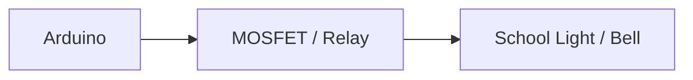

# Урок 4 — Керуємо підсвічувачем 💡

> **Mission:** у момент події Arduino не лише грає трек, а й вмикає фізичне навантаження.



## Безпека

> ⚠️ Для навчального прототипу спочатку використовуємо **світлодіод або інше безпечне низьковольтне навантаження**. Діти не працюють з мережевою напругою 220 В. Усе, що стосується 220 В, підключає або перевіряє дорослий фахівець.

## Обладнання

| Компонент | Статус |
| --- | --- |
| Світлодіод + резистор | для першої версії |
| MOSFET-модуль або реле | **модель не визначена**; потрібні напруга/струм навантаження |

## Логіка

```text
10:15
   ↓
Arduino
   ├── Play Track
   └── Turn Light ON
```

## Definition of Done

- [ ] Світлодіод вмикається разом із треком.
- [ ] Вимикається, коли трек завершився.
- [ ] Після перезавантаження Arduino навантаження вимкнене (безпечний стан).
