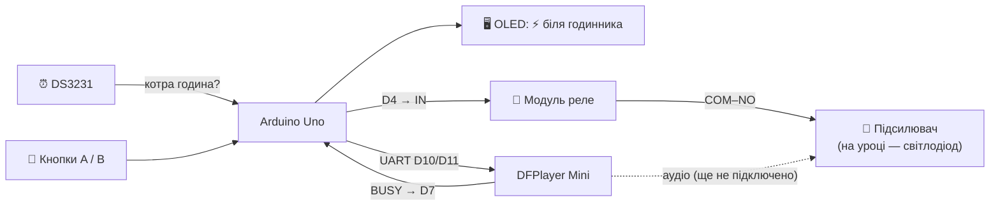
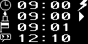
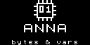

# Урок 4 — Розбуди підсилювач ⚡

> **Mission:** за хвилину до події Arduino **сам вмикає підсилювач** через реле, тримає його, поки грає трек, і **вимикає**, коли все стихло.

> Сторінка-презентація для класу (тема — Стамбул): [presentation.html](presentation.html).

Урок 4 продовжує [урок 3](../lesson-03-show-and-set/). Дроти DFPlayer, DS3231, OLED і кнопок лишаються як були. Додаємо **модуль реле** на вільний пін **D4**. На уроці замість справжнього підсилювача реле вмикає **світлодіод від 5 В**.



## ⚠️ Спершу — безпека

Реле існує саме для того, щоб **слабкий** Arduino керував **сильним** струмом. Тому цей урок починається з правил.

### Що робить струм з людиною

Небезпечна не «напруга сама по собі», а **струм, що йде крізь тіло**. Струм = напруга / опір (закон Ома). Опір тіла людини — від ~1 кОм (мокра шкіра) до ~100 кОм (суха).

| Струм крізь тіло (змінний, 50 Гц) | Що відбувається |
| --- | --- |
| ~1 мА | відчуваєш поколювання |
| ~10 мА | м'язи стискаються — **не можеш відпустити** дріт |
| ~30 мА | важко дихати; на цей струм розраховане ПЗВ (пристрій захисного вимкнення) |
| 50–100 мА | **серце може зупинитися** (фібриляція) |

Порахуймо: **220 В / 1 кОм ≈ 220 мА**. Це в кілька разів більше за смертельний струм. А **5 В / 1 кОм = 5 мА**: Arduino і USB безпечні, тому на уроці ми працюємо тільки з ними.

### Правила уроку

1. **Учні не торкаються мережі 220 В.** Підключення підсилювача до 220 В і перевірку робить лише дорослий електрик.
2. На уроці реле вмикає **світлодіод від 5 В** — так само клацає і так само видно результат.
3. **На модулі реле гвинтові клеми і пайка знизу** можуть бути під 220 В. Готовий пристрій — лише в закритому корпусі.
4. Будь-які зміни в дротах — **тільки при вимкненому живленні** (USB від'єднано).
5. Мокрі руки, металевий браслет, «перевірю пальцем» — ні.
6. Шкільна мережа має бути з **ПЗВ на 30 мА** (перевіряє дорослий).
7. Струм реле має бути **з запасом**. Підсилювач на 200 Вт бере з мережі ~1 А. Під час увімкнення трансформатор на мить бере в рази більше (пусковий струм). Тому навіть «10 А 250 В» на корпусі реле — не гарантія. Модель реле ще **не обрана**, і рішення має перевірити дорослий.

## Обладнання

| Компонент | Статус |
| --- | --- |
| Arduino Uno + DFPlayer Mini + динамік (урок 1) | підтверджено |
| DS3231 (урок 2) | підтверджено, I²C 0x68 |
| OLED SSD1306 + 2 кнопки (урок 3) | підтверджено для уроку 3 |
| **Модуль реле 5 В, 1 канал** | **модель не обрано.** Скетч розрахований на типовий модуль з транзистором і входом IN. Модуль у класі вмикається рівнем **LOW**, і скетч уже налаштований на це (`RELAY_ACTIVE_LOW = true`). Струм/напругу контактів і порядок виводів — перевірити на своєму модулі |
| Світлодіод + резистор 220 Ом | «підсилювач» для уроку |
| Підсилювач і пульт | уже є в школі; вхід для аудіо і рівень сигналу **ще не перевірено** |

## Схема підключення

Дроти уроків 1–3 **не чіпаємо**. Додаємо:

| Звідки | Куди | Навіщо |
| --- | --- | --- |
| Реле IN | Uno **D4** | команда «увімкни» |
| Реле VCC | Uno 5V | живлення котушки (через транзистор на модулі) |
| Реле GND | Uno GND | спільна «земля» |
| Реле COM | Uno 5V | «живлення підсилювача» (на уроці) |
| Реле NO | резистор 220 Ом → світлодіод (+) | «підсилювач» |
| Світлодіод (−) | GND | |

- **COM** — спільний контакт, **NO** (normally open) — розімкнений, доки реле не увімкнене, **NC** (normally closed) — навпаки. Нам потрібні **COM і NO**: якщо Arduino вимкнеться або зависне під час RESET, підсилювач теж вимкнеться.
- Справжній підсилювач: COM–NO стають **у розрив одного дроту** живлення підсилювача. Цю частину робить лише дорослий електрик (див. «Безпека»).
- Котушка реле бере ~70–90 мА. Це забагато для піна Arduino (≈20 мА), тому на модулі стоїть транзистор і діод. **Голе реле без модуля напряму до піна не підключаємо.**

**Зайняті піни після уроку 4:** D2, D3 (кнопки), **D4 (реле)**, D7 (BUSY), D10/D11 (DFPlayer), A4/A5 (I²C: годинник 0x68 + дисплей 0x3C).

## Теорія

### Реле — вимикач, який натискає магніт

1. Arduino подає на IN рівень «увімкнути».
2. Транзистор на модулі пропускає струм через **котушку**, і котушка стає електромагнітом.
3. Магніт притягує залізний **язичок**, і той перекидає контакт: **COM з'єднується з NO**. Чути «клац», світиться світлодіод на модулі.
4. Котушка (5 В, десятки мА) і контакти (до сотень вольт) **ніде не з'єднані** дротом. Між ними тільки магнітне поле і повітря. Так «слабке» безпечно керує «сильним».
5. Струм у котушці вимкнули — пружина повертає язичок, і коло розривається. Котушка в цю мить дає стрибок напруги, тому на модулі стоїть **діод**, який його гасить.

### Чому заздалегідь, а не в ту саму секунду

Підсилювачу потрібен час, щоб «прокинутися»: зарядити конденсатори і ввімкнути захист колонок. Якщо одразу подати звук, перші слова загубляться, а в колонках може «бахнути». Тому:

| Час | Що робить пристрій |
| --- | --- |
| 08:59:00 | до хвилини мовчання ≤ 60 с (`AMP_LEAD_SEC`) → **реле УВІМК**, ⚡ на екрані |
| 09:00:00 | хвилина мовчання (BUSY = LOW → ▶) |
| 09:01:00 | гімн; реле **не клацає** між подіями |
| кінець гімну + 15 с | тиша вже `AMP_HOLD_MS` → **реле ВИМК** |

Ручний `PLAY`, коли підсилювач вимкнений: реле вмикається, скетч чекає **3 с** (`AMP_WARMUP_MS`, стан `STATE_WARMING`) і лише потім запускає трек. Жодного `delay()`: кнопки, меню і годинник працюють і під час прогріву.

### Безпечний стан

- У `setup()` **першим рядком** реле вимикається: спершу записуємо рівень, потім робимо пін виходом. Так пін не «смикне» реле під час старту.
- Немає часу (годинник зник або не встановлений) → заздалегідь не вмикаємо. Нічого не грає → вимикаємо через 15 с.
- Реле **не повідомляє**, чи підсилювач справді увімкнувся. Тому скетч пише «Реле: УВІМК», а не «підсилювач працює». Перевірка — світлодіод на модулі і звук у колонках.

### HIGH чи LOW?

Одні модулі вмикаються рівнем **HIGH**, інші — **LOW**, а деякі мають перемичку H/L. Наш модуль у класі вмикається **LOW**: зі значенням `false` реле горіло одразу після старту Arduino. Тому в скетчі `RELAY_ACTIVE_LOW = true`:

| Рівень на D4 | Реле |
| --- | --- |
| **HIGH** | вимкнене (так і після старту) |
| **LOW** | увімкнене |

Інший модуль, що вмикається **HIGH** (і реле в симуляторі Wokwi), — поставте `false`.

## Екран

| Запуск: логотип команди | Подія, реле увімкнене |
| --- | --- |
|  |  |

**Заставка.** Під час запуску (≥ 2 с, `LOGO_MS`) — логотип команди з [`../logo.jpg`](../logo.jpg): «STEM-93», звукова хвиля і лінія із зіркою (підпис «DREAM TEAM» на екрані прибрали). Картинка 128×64 лежить у [`sketch/logo.h`](sketch/logo.h): 1024 байти у флеш-пам'яті (PROGMEM), там само намальована з `#`. «STEM» і хвиля зменшені з картинки. «-93» і лінію із зіркою домальовано вручну в тому ж стилі: цифр у картинці немає, а тонка лінія на 1 пікселі розсипалась. На екран логотип іде клітинками 8×8, тож у RAM одночасно лише 8 байтів.

**⚡** біля годинника — реле увімкнуло підсилювач. Інші позначки (⚠, 🔇, ✓) важливіші, тому показуються замість ⚡. Скріншот з Wokwi.

## Кнопки: скасувати і демо-режим

| Кнопки | Що робить |
| --- | --- |
| A+B коротко (менше 1 с), нічого не грає | меню, як в уроці 3 |
| A+B коротко, **поки грає** (або прогрівається підсилювач) | **скасувати**: трек зупиняється (як `STOP`). Реле вимикається само через 15 с тиші |
| A+B **тримати 20 с** | **демо-режим**. Через 1 с замість годинника з'являється відлік ▶ `00:19`, `00:18`… Відпустили раніше — нічого не станеться |
| у демо: A або B | наступна картка |
| у демо: A+B коротко | вийти з демо |

На головному екрані A+B тепер спрацьовує на **відпускання**, бо одразу не відомо, чи людина триматиме 20 с. У меню A+B — це «OK», і воно, як і раніше, спрацьовує одразу.

**Демо** показує все, що вміє пристрій:

1. логотип STEM-93;
2. п'ять карток команди по 3 с (`DEMO_CARD_MS`): картинка 32×32, ім'я великими літерами і роль;
3. пристрій показує себе сам: реле вмикається (⚡), 3 с прогріву, потім цитата дня (▶ біля хмаринки). Коротко A+B зупиняє і її.

Якщо під час карток настає подія за розкладом, демо закривається: розклад важливіший.

| Олекса | Денис | Евеліна | Дарина | Анна |
| --- | --- | --- | --- | --- |
|  |  |  |  |  |
| жук: шукає баги | магніт: історія про реле | дошка Kanban | ноти: логотип і цитати в MP3 | мікросхема «01»: змінні й пам'ять |

Шрифт U8x8 не має кирилиці, тому імена на екрані латиницею. Картинки — звичайні іконки 16×16 з [`sketch/icons.h`](sketch/icons.h), функція `drawScaled()` малює їх удвічі більшими. Тим самим способом збільшено й літери імені: власна функція займає менше флешу, ніж бібліотечна `draw2x2String()`.

**Пам'ять (тема Анни).** Демо майже не влізло у флеш Uno: 33 154 Б при межі 32 256. Місце звільнили двома змінами:

- власний `drawScaled()` замість `draw2x2String()` дав −600 Б;
- у команді `SET` маленька функція `parseDateTime()` замінила `sscanf()`: він тягнув за собою ~1 КБ бібліотечного коду. Формат команди той самий.

## Команди Serial Monitor

Як в уроці 3 (`SET`, `NOW`, `SCHEDULE`, `PLAY`, `STOP`, `CLOCK ON/OFF`, `HELP`), плюс:

| Команда | Що робить |
| --- | --- |
| `AMP` | показати стан реле |
| `AMP ON` | увімкнути вручну (наприклад, оголошення в мікрофон) |
| `AMP OFF` | вимкнути вручну; треки грають, але в колонках тиша — скетч попереджає |
| `AMP AUTO` | знову за розкладом |

`STOP` і коротке A+B під час звуку роблять одне й те саме (функція `stopPlayback()`).

## Демо «Розбуди підсилювач»

1. `SET 2026-10-16 08:59:50` → одразу `Реле: УВІМК (авто)`, клац, світлодіод горить, ⚡ на екрані.
2. 09:00 — хвилина мовчання, 09:01 — гімн. Реле між ними не клацає.
3. Через 15 с після гімну → `Реле: ВИМК (авто)`.
4. `PLAY 7` → `Реле: УВІМК`, «Прогріваємо підсилювач...», через 3 с — трек.

Вивід (Wokwi, сценарій [`wokwi/test-relay.yaml`](wokwi/test-relay.yaml)):

```text
Годинник встановлено: 2026-10-16 08:59:50
Реле: УВІМК (авто)
⏰ НАСТАВ ЧАС ПОДІЇ 1) 09:00 → треки 4-6 (хвилина мовчання)
Команда: відтворити трек 6
ГРАЄ: відтворення підтверджено (BUSY = LOW).
ГОТОВО: трек більше не грає.
⏰ НАСТАВ ЧАС ПОДІЇ 2) 09:01 → треки 1-3 (гімн України)
Команда: відтворити трек 3
ГРАЄ: відтворення підтверджено (BUSY = LOW).
ГОТОВО: трек більше не грає.
Реле: ВИМК (авто)
Реле: УВІМК (авто)
Прогріваємо підсилювач...
Команда: відтворити трек 7
ГРАЄ: відтворення підтверджено (BUSY = LOW).
```

### Якщо щось не так

| Симптом | Що перевірити |
| --- | --- |
| реле клацає одразу після RESET і горить весь час | рівень не той: модуль вмикається не так, як записано в `RELAY_ACTIVE_LOW` → змініть `true` ↔ `false` |
| `Реле: УВІМК`, а клацання немає | IN → D4? VCC → 5V? GND спільний? |
| клацає, а світлодіод не горить | COM і NO (не NC)? полярність світлодіода, резистор |
| Arduino перезапускається, коли клацає реле | бракує струму від USB → окреме живлення 5 В для модуля (спільний GND) |
| реле не вмикається заздалегідь | годинник має показувати час (`NOW`); чи не стоїть `AMP OFF` |

## Відкриті питання

- Модель реле: напруга й струм контактів, рівень увімкнення, порядок виводів.
- Як саме увімкнути шкільний підсилювач: розрив живлення через реле чи його власний вхід «увімкнути» (якщо є).
- Аудіо в підсилювач: DFPlayer має лінійний вихід (DAC_L / DAC_R). Вхід підсилювача і рівень сигналу ще не перевірено, тож у схемі його поки немає.
- Час прогріву конкретного підсилювача (`AMP_WARMUP_MS`, зараз 3 с).

## Збірка

- Arduino IDE: відкрити `sketch/sketch.ino` (поруч мають лежати `icons.h` і `logo.h`), плата **Arduino Uno**. Бібліотеки ті самі, що в уроці 3: **DFRobotDFPlayerMini**, **RTClib**, **U8g2**. Для реле нових бібліотек не треба.
- arduino-cli:

  ```sh
  arduino-cli lib install DFRobotDFPlayerMini RTClib U8g2
  arduino-cli compile --fqbn arduino:avr:uno --export-binaries lessons/lesson-04-wake-the-amp/sketch
  ```

## Симуляція у Wokwi

[`wokwi/diagram.json`](wokwi/diagram.json) — схема уроку 3 + `wokwi-relay-module` (IN → D4) + помаранчевий світлодіод «AMP» через 220 Ом на контакті NO.

Як зібрати проєкт на wokwi.com:

1. Відкрийте проєкт уроку 3 (або [урок 2](https://wokwi.com/projects/477985449630706689)) → **Save a copy**.
2. Замініть `sketch.ino` на [`sketch/sketch.ino`](sketch/sketch.ino), `icons.h` — на [`sketch/icons.h`](sketch/icons.h) (у ньому нові іконки: ⚡ і п'ять картинок команди для демо), додайте новий файл `logo.h` з [`sketch/logo.h`](sketch/logo.h), а `diagram.json` — на [`wokwi/diagram.json`](wokwi/diagram.json).
3. Library Manager → **U8g2**, **RTClib**, **DFRobotDFPlayerMini** (якщо ще немає).
4. **У `sketch.ino` поставте `RELAY_ACTIVE_LOW = false`**: реле в Wokwi вмикається HIGH, а скетч налаштований на наш модуль, що вмикається LOW. Інакше в симуляції реле горітиме одразу після старту.
5. ▶ → `SET 2026-10-16 08:59:50`. Реле клацне, і «AMP» засвітиться.

**Wokwi CLI (локально):** [`wokwi/wokwi.toml`](wokwi/wokwi.toml) бере `.hex` з `sketch/build/`.

```sh
wokwi-cli --scenario test-relay.yaml lessons/lesson-04-wake-the-amp/wokwi
```

| Сценарій | Що перевіряє |
| --- | --- |
| [`test-relay.yaml`](wokwi/test-relay.yaml) | (для реле Wokwi, `RELAY_ACTIVE_LOW = false`) D4 = 0 після старту; реле за хвилину до події; не вимикається між мовчанням і гімном; вимикається через 15 с; прогрів перед ручним `PLAY`; `AMP OFF` / `AMP AUTO` |
| [`test-menu.yaml`](wokwi/test-menu.yaml) | меню з уроку 3 працює як раніше |
| [`test-quote.yaml`](wokwi/test-quote.yaml) | випадкова цитата з уроку 3 |
| [`test-demo.yaml`](wokwi/test-demo.yaml) | `PLAY 7` → клік A+B → стоп; утримання A+B 20 с → демо → реле, прогрів, цитата → клік A+B → стоп |

## Definition of Done

- [ ] Кожен учасник може пояснити, чому 220 В небезпечні, а 5 В — ні (закон Ома, струм крізь тіло).
- [ ] Модуль реле на D4, уроки 1–3 працюють як раніше.
- [ ] Після RESET реле **вимкнене**.
- [ ] За хвилину до події реле вмикається, на екрані ⚡.
- [ ] Між хвилиною мовчання і гімном реле не клацає.
- [ ] Через 15 с після кінця треку реле вимикається.
- [ ] Ручний `PLAY` чекає прогріву 3 с.
- [ ] Коротко A+B під час треку зупиняє його; утримання A+B 20 с запускає демо з усією командою.
- [ ] Денис пояснює, як працює реле: котушка, язичок, COM/NO/NC, навіщо діод і транзистор.

## Стан перевірки

| Перевірка | Результат |
| --- | --- |
| Компіляція (arduino-cli 1.5.1, `arduino:avr:uno`, DFRobotDFPlayerMini, RTClib, U8g2 — ті самі версії, що в уроці 3) | ✅ Uno: 30 974 Б flash (96 %), 1 113 Б RAM (54 %) з `RELAY_ACTIVE_LOW = true`, логотипом і демо-режимом |
| Wokwi CLI: `test-relay.yaml` (зі скетчем, де `RELAY_ACTIVE_LOW = false`; з `true` тест не пройде, бо реле Wokwi вмикається HIGH) | ✅ D4 = 0 після старту; `Реле: УВІМК` о 08:59:50 (за 10 с до події); D4 = 1 під час гімну; `Реле: ВИМК` через 15 с; `PLAY 7` → прогрів → «ГРАЄ»; `AMP OFF` → D4 = 0 |
| Wokwi CLI: `test-menu.yaml`, `test-quote.yaml` (з уроку 3) | ✅ пройшли до демо-режиму. З демо: `test-quote` ✅; `test-menu` ❌ знайшов баг (A+B закривало меню і відразу на відпусканні відкривало знову) → виправлено, повторний прогін ⏳ не завершено: закінчилась місячна квота Wokwi CI |
| Wokwi CLI: `test-demo.yaml` | ✅ пройшов (до виправлення бага меню, яке цього шляху не стосується); після виправлення ⏳ не повторено — квота Wokwi |
| Wokwi CLI: `test-relay.yaml` після демо-режиму | ⏳ не повторено — квота Wokwi |
| Wokwi: картки демо | ✅ `img/oled-demo-1…5.png` |
| Wokwi: скріншот екрана з ⚡ | ✅ [`img/oled-amp-playing.png`](img/oled-amp-playing.png) |
| Wokwi: логотип при запуску | ✅ [`img/oled-logo.png`](img/oled-logo.png) — піксель у піксель збігається з `logo.h` |
| Проєкт на wokwi.com | ⏳ ще не створено (файли — вручну, див. вище) |
| Справжній модуль реле: рівень увімкнення | ⚠️ на уроці з `false` реле горіло одразу після старту → модуль вмикається LOW, скетч змінено на `true` |
| Справжній модуль реле зі скетчем `RELAY_ACTIVE_LOW = true`: вимкнене після старту, клацає за розкладом | ⏳ не перевірено |
| Підсилювач школи через реле (220 В, лише дорослий електрик) | ⏳ не виконано |
