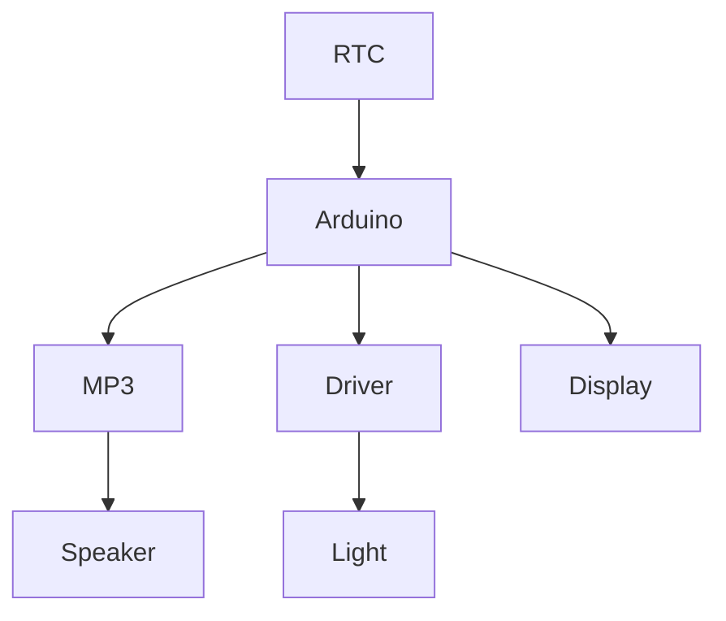
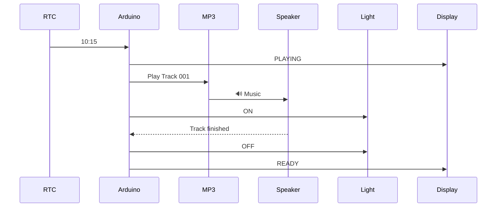

# Урок 6 — Integration & QA 🧪 + Final Demo

> **Mission:** усі частини працюють разом. QA отримує завдання: **спробуйте зламати систему.**

## Test cases

| Scenario | Expected | Result |
| --- | --- | --- |
| Before event | Nothing happens | |
| Event time | Track starts | |
| Event time | Light turns ON | |
| After event | System returns to READY | |
| Restart Arduino | System continues correctly | |
| Missing MP3 | Error / safe behaviour | |
| Wrong track | Error | |
| Event occurs twice | Track plays only once | |
| Power interruption | System recovers | |

## Final Demo

Команда задає тестовий час **10:15**. Система сама:

1. визначає час;
2. знаходить подію;
3. запускає потрібний трек;
4. вмикає підсвічувач;
5. показує статус;
6. завершує подію;
7. повертається у `READY`.

## Definition of Done

> **"We built it, we understand it, and we tested it."**

Кожна дитина може пояснити свою частину: що підключили, навіщо, як частини спілкуються, що відбувається в момент події, як ми перевіряємо роботу.
